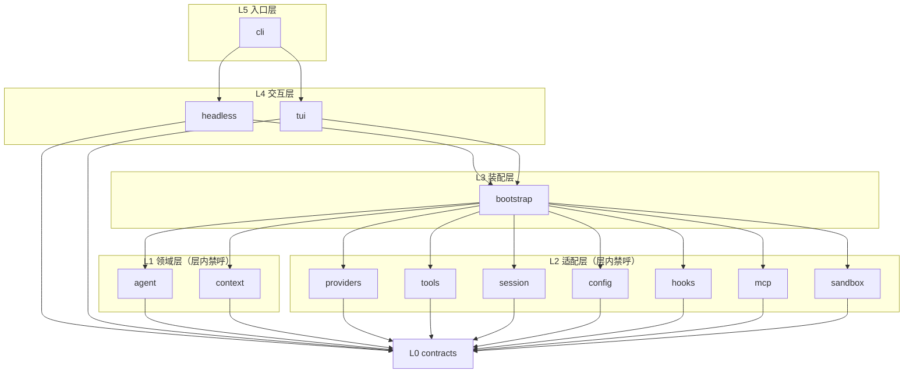
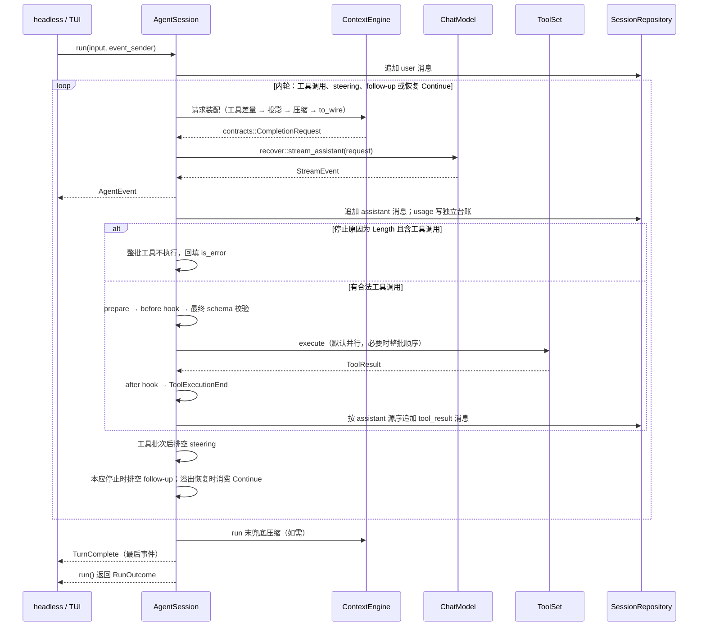

# 架构

> 本文件承载 Pixbot 作为编码 Agent 的终态技术蓝图：全局分层、跨领域不变量、装配边界、扩展边界、非功能目标与领域导航。功能模块的终态行为由[领域设计](#领域设计导航)分别承载，交付顺序、版本只由 [roadmap.md](roadmap.md) 承载，长期取舍见 [decisions.md](decisions.md)。文中涉及 pi 快照的表述一律以 `resources/pi/` 源码为唯一事实来源，出处索引见 [pi-architecture](../resources/pi-architecture.md)。

## 设计立场

Pixbot 是一个**最小、可扩展的编码 Agent Harness**：内核只维护转录、驱动模型与工具循环、暴露事件；provider、工具、持久化、扩展与前端通过端口协作。行为扩展走编译期端口，生态扩展走进程外协议与提示资源；不嵌入额外语言运行时。终态交付形态是本地优先的单一静态 Rust 二进制，自有前端收敛为 headless 与 TUI，不做 repl。

| 立场 | 终态结论 |
|---|---|
| 内核 | `agent` + `context` 的合称；只做三件事：维护转录、驱动“模型 ⇄ 工具”循环、暴露事件；不含 UI、协议映射、工具语义与安全策略 |
| 状态 | 转录是唯一事实源；持久化只追加；运行期状态只有双队列、取消令牌与未完成调用集合 |
| 扩展 | 编译期端口承载行为扩展；进程外 hooks／MCP 与提示资源承载生态扩展；不嵌入运行时脚本 |
| 安全 | 不内置逐工具权限／审批子系统；约束由通用 hooks、OS sandbox 与 project trust 承接 |
| 前端 | headless 与 TUI 共用 `AgentSession`；前端只消费事件与结果，不持有内核状态 |
| 基线 | 以固定 pi 快照为行为对齐基线，不自动跟踪上游新增能力 |
| 取舍 | 不照搬 pi 的 codemode／durable／env／chord／telemetry 产品线，不提供子代理编排 DSL、plan mode 专用语义、多租户服务端或 repl |

## 术语与口径

本节只定义本文使用的词，不替代领域设计。括号内的「Pixbot 命名」表示该词不是 pi 标识符，不得到 pi 快照中寻找同名实现。

### 内核的构成

本文的**内核**是 L1 领域层中 `agent` 与 `context` 两个 crate 的合称；其中 `agent` 是**控制内核**，`context` 是**上下文内核**。`contracts` 是 L0 共享契约，不属于内核；`session`、`providers`、`tools`、`config`、`hooks`、`mcp`、`sandbox` 是 L2 适配器；`bootstrap` 是装配层；`headless`、TUI、`cli` 是前端与入口。安全策略、工具业务语义、持久化与协议映射都在内核之外。

```text
内核（L1 领域层）
├── agent（控制内核）
│   ├── driver    双层循环、内轮边界与队列排水
│   ├── state     运行时转录、双队列、取消令牌与未完成调用集合
│   ├── events    事件构造、配对与串行发送
│   ├── dispatch  工具预备、执行与结果回填
│   └── recover   调用级重试、溢出压缩协调与恢复 Continue
└── context（上下文内核）
    └── ContextEngine  投影、system 装配、工具差量、to_wire、CompletionRequest 与压缩计划
```

| 名称 | 具体指向 | 不属于 |
|---|---|---|
| 内核 | `agent` + `context` | `contracts`、L2 适配器、`bootstrap`、前端 |
| 控制内核 | `agent` crate；五个模块见上 | 上下文投影与压缩算法、会话落盘、Provider 协议 |
| 上下文内核 | `context` crate 中的 `ContextEngine` | 驱动循环、工具执行、持久化、模型选择 |
| 共享契约 | `contracts` 的 DTO、端口、事件与错误 | 任何运行时实现或 I/O |

> pi 的 `pi-agent-core` 只对应本文的「控制内核」，不含上下文工程；pi 的上下文转换与压缩在 `coding-agent` 与 `ai` 中。本文用「内核」合称 `agent` + `context`，表达的是 Pixbot 的 L1 边界，不是照搬 pi 的包结构。[Agent 设计](design/agent.md)中的「Agent 内核」与本文的「控制内核」同义；上下文内核的语义见[上下文设计](design/context.md)。
>
> 正文中单独出现的「内核」均指上述合称；需要特指时使用「控制内核」或「上下文内核」。

### 核心术语

| 术语 | 本文口径 | 边界／不是 |
|---|---|---|
| 转录（transcript） | 会话内按发生顺序**只追加**的条目集合；终态为 `TranscriptEntry` 条目树，当前叶子决定可见分支。它记录“发生过什么”，是会话的唯一事实源。 | 不是发给模型的 wire 消息列表，不是 UI 渲染缓存，不是用量台账，也不是工具大输出文件。 |
| 会话（session） | 一次可恢复的持久化容器：会话转录（`context.jsonl`）、独立用量台账与工具大输出位置约定；由 `SessionRepository` 读写。 | 不等于单次 `run()`；一个会话可包含多次 `run()`、resume 与 fork。 |
| 条目（entry） | `TranscriptEntry` 的一条记录：`Message`、`Compaction`、`Label`、`ContextEdit` 等；消息条目带 `uuid`／`parent_uuid`。 | 不是 wire role；`Compaction` 不是普通 assistant 消息，`ContextEdit` 不是改写原消息。 |
| 消息双轨 | 领域 `Message`（可扩展变体）与 wire 消息（system／user／assistant／tool 四角色）分开；`ContextEngine::to_wire` 是唯一领域 → wire 边界。 | Provider 不解释领域变体；领域层不持有厂商 JSON。 |
| 工具结果三词 | `ToolResult` 是工具执行结果 DTO；`Content::ToolResult` 是消息内容块变体；`tool_result` 消息是回填进转录的消息。 | 三者不得混用；`ToolExecutionEnd` 只从 `ToolResult.is_error` 读取失败语义。 |
| `run()`（运行，口语也称“回合”） | 一次 `AgentSession::run` 调用，从输入到 `RunOutcome`；不可重入，可包含多个内轮、压缩、steering／follow-up 与恢复。 | 不是单个模型请求；`RunOutcome` 不是第二个结束事件。 |
| 内轮（turn，亦称轮次；「内轮」为 Pixbot 命名） | 一次 `TurnStart` → `TurnEnd` 的模型响应周期：请求装配、流式 assistant、可选工具批次与结果回填；一次 `run()` 可含多个内轮。 | 不是整个 `run()`；`TurnComplete` 只在 `run()` 末尾出现一次。 |
| 驱动模块（`driver`；Pixbot 命名） | `agent` 内的控制流模块：外层 `run()` 生命周期、内层内轮推进、内轮边界与队列排水；只调用端口，不亲自执行模型流、工具、持久化或投影。 | 不是模型、不是工具执行器、不是调度服务；不直接写会话文件。 |
| 工具循环 | 由 `driver` 推进的“模型 → 工具 → 模型”循环：模型返回 `tool_use` → `dispatch` 预备、校验、执行 → 回填 `tool_result` → 下一个内轮，直到没有工具调用或停止原因终止。 | 不是子代理循环，不是独立进程，也不是 MCP 连接管理。 |
| `dispatch` | `agent` 内模块：prepare → before hook → 最终 schema 校验 → execute → after hook → `ToolExecutionEnd`；未知工具、参数错误、hook 阻断也归一化为 `is_error` 结果。 | 不含工具业务语义（在 `tools`），不含安全策略（在 hooks／sandbox），不拥有权限模式。 |
| 投影（projection） | 从转录树、当前叶子、最新 `Compaction` 与 `ContextEdit` 计算出站有效上下文；确定性、只读转录。 | 不删除或改写转录；不等于 wire 转换；`microcompact` 在其后处理出站副本。 |
| 请求装配 | 从工具差量到 `CompletionRequest` 的确定性管线：`declare_tool_changes → project_tree → prepare_request → [compaction] → microcompact → to_wire → normalize`；system 装配由 `ContextEngine` 负责，稳定分节在前、动态分节在后。 | 不做模型路由或选择；厂商 JSON 映射在 Provider。 |
| 压缩／`microcompact` | `Compaction` 是追加的摘要条目，投影只采用最新摘要；`microcompact` 只清理出站副本中的遮蔽条目与过期注入段。 | 不是删除历史、不是覆盖原消息；`microcompact` 不改写转录。 |
| 恢复（`recover`） | `agent::recover`：调用级整轮重试、溢出压缩协调与一次恢复 Continue。 | 不是 Provider 的响应头前重试；abort 不重试；不是无限重试。 |
| 工具差量 | 工具面变化的领域事实；同名定义变化按“删除 + 新增”记录，作为 system 消息追加并参与投影，回放可重建工具面。 | 不是每轮重发完整工具列表，也不是 Provider 缓存标记。 |
| 端口／适配器／装配 | 端口是 `contracts` 的 trait、DTO、事件与错误；适配器是 L2 的 `providers`／`tools`／`session`／`config`／`hooks`／`mcp`／`sandbox`；装配是 `bootstrap` 注入实现并返回 `Core`。 | 内核不依赖适配器具体类型；适配器不反向依赖内核。 |
| 前端 | `headless` 与 TUI；消费 `AgentEvent` 与 `RunOutcome`，持有输入／渲染状态。 | 不是内核的一部分；不直接调用 Provider、工具或存储实现。 |
| 事件／`RunOutcome` | `AgentEvent` 是运行中有序事件流，`TurnComplete` 恒为最后事件；`RunOutcome` 是 `run()` resolve 后的返回值。 | `RunOutcome` 不是第二个结束事件；`TurnEnd` 不是 `run()` 结束。 |
| 用量台账 | `UsageRecord` 独立记录 token／cost 等用量。 | 不属于转录，不参与投影，不是会话条目。 |

### 状态模型

「设计立场」与「全局边界」中的「状态」行都是**终态结论**：描述最终架构选定的做法，不描述当前实现进度；现状以仓库代码与测试为准。

状态被刻意分成两层，二者不重叠：

| 层 | 内容 | 作用 | 不承担 |
|---|---|---|---|
| 事实层 | 转录（`TranscriptEntry` 条目树） | 记录“发生过什么”，是唯一事实源 | 不记录“现在进行到哪”，不作 UI 缓存 |
| 运行期层 | 双队列、取消令牌、未完成调用集合 | 记录“现在进行到哪” | 不承载历史，不跨 `run()` 持久化 |

**转录是唯一事实源。** 投影结果、wire 消息、UI 渲染、用量台账与工具大输出文件都从转录派生或旁路存放：删掉它们可以从转录重建，反过来不行。

**持久化只追加。** 会话文件只追加新条目，从不原地改写；压缩、`ContextEdit`、`Label`、分支与 fork 都以新条目或新文件表达；加载只读，坏行跳过并记诊断。因此终态架构里不存在“历史被修改”，只有“新条目改变投影结果”。

**运行期状态只有三样。** 除转录之外，`agent` 在内存中只保留：

| 运行期状态 | 指什么 | 生命周期 |
|---|---|---|
| 双队列 | steering 与 follow-up 两个待处理消息队列 | 跨内轮存活，随 `run()` 上下文销毁 |
| 取消令牌 | 当前 run 的协作取消信号 | 绑定单次 `run()` |
| 未完成调用集合 | 已发出 `tool_use` 但尚未回填 `tool_result` 的调用 | 每个工具批次内收敛为空 |

Provider 连接、工具进程、MCP 会话、缓存与 UI 输入缓冲都是适配器或前端的私有状态，不属于内核状态，也不进入转录。

一句话口径：“发生过什么”只在转录里；“现在进行到哪”只在双队列、取消令牌与未完成调用集合里；其余都是派生视图或适配器私有状态。

## 对标 pi 的取舍

pi 的实测内核只有循环、状态与事件三职责，LLM 调用经注入的 `StreamFn`，转录是唯一事实源，消息分为应用侧与 LLM wire 两轨。Pixbot 沿用这些结构，并在事件收尾、错误字段、hook 校验与持久化纪律上做显式收紧。

| 主题 | pi 快照实际行为 | Pixbot 终态取舍 |
|---|---|---|
| 内核 | `pi-agent-core` 只有 6 个源文件；循环、状态、事件三职责；LLM 调用经注入的 `StreamFn`（`resources/pi/packages/agent/src/`） | 同三职责；`ChatModel` 端口注入；内核不感知 provider、工具、持久化与前端 |
| 状态与消息 | 转录是唯一事实源；system prompt 与工具声明以 system message 存活在转录中；`AgentMessage` 与 LLM `Message` 双轨，`convertToLlm` 是唯一下降边界 | 同源与双轨；工具差量作为领域事实追加，system 由投影装配；`ContextEngine::to_wire` 是唯一领域 → wire 边界 |
| 事件与收尾 | `AgentEvent` 为 10 个变体；`agent_end` 之后仍需 `waitForIdle()` 等待监听器 settle | `TurnComplete` 恒为最后事件；`run()` resolve 即 settled；`RunOutcome` 是返回值而非第二个结束事件；`ModelStopReason` 与 `RunStopReason` 分型 |
| 工具执行 | 预备串行、执行默认并行；`tool_execution_end` 带外层 `isError`；`afterToolCall` 可逐字段覆盖 `isError`／`usage`／`terminate` | 同执行顺序；失败只从 `ToolResult.is_error` 读取；after hook 只允许替换三通道内容字段，不得覆盖内核控制的 `is_error`／`terminate`／`usage` |
| 重试 | provider 层只重试响应头之前；`retryAssistantCall` 位于 `pi-ai` | provider 层保持同一边界；调用级整轮重试收归 `agent::recover::stream_assistant` 唯一入口，abort 不重试 |
| 会话 | JSONL 条目树，惰性建文件、同步追加；写失败回滚内存并抛出（fail-closed） | 同条目树与惰性建文件；防抖 writer、写盘 fail-open、加载只读、坏行跳过并记诊断 |
| 扩展 | TS 扩展经 jiti 直载；大量扩展事件；工具可按暴露级别进入或离开模型工具列表 | 编译期端口 + 进程外 hooks／MCP + 受 trust 控制的提示资源；不嵌入运行时；工具来源可插拔且注册序稳定 |
| 前端 | TUI／print／JSON／RPC／SDK 共用内核 | headless + TUI 共用 `AgentSession`；不做 repl；更多集成前端只增加画像与装配入口 |
| 安全 | 无内建权限系统，默认继承启动进程权限；建议整进程容器化 | 同无权限子系统；hooks、sandbox、project trust 分别承接执行约束、OS 隔离与资源加载门 |
| 产品线 | codemode／durable／env／chord／telemetry 独立存在 | 明确不做这些产品线；本地 trace／回放属于观测能力，不作为联网遥测产品 |

核对索引（行内代码，按包归并）：内核契约与循环见 `resources/pi/packages/agent/src/{types,agent,agent-loop,stream-fn}.ts`；消息、流事件与 provider 见 `resources/pi/packages/ai/src/{types,models}.ts`；会话、压缩与系统提示见 `resources/pi/packages/coding-agent/src/core/{agent-session,session-manager,system-prompt}.ts`；工具、扩展与压缩见 `resources/pi/packages/coding-agent/src/core/{tools,extensions,compaction}/`；前端分流见 `resources/pi/packages/coding-agent/src/main.ts`。

pi 的 `coding-agent` 把会话编排、压缩、工具与扩展收在同一包内，前端由 modes 与独立 TUI 包承载；Pixbot 保留其运行语义，但按端口边界拆成 `agent`、`context`、`session`、`tools`、扩展适配与前端，避免单包耦合。Pixbot 的 `hooks` 是进程外通用 hook，不对应 pi 的进程内 TS 扩展事件；`sandbox` 是 Pixbot 自建增强，pi 没有内建 OS sandbox，官方立场是整进程容器化（`resources/pi/packages/coding-agent/docs/security.md`、`containerization.md`）。

## 全局边界

Pixbot 采用六边形端口架构。内核维护转录、驱动模型与工具循环并暴露事件；provider、工具、持久化、扩展与前端通过端口协作。安全策略不进入内核：通用 hook 的适配点位于工具 `dispatch`，OS sandbox 位于子进程执行边界，project trust 位于配置与资源加载边界。

| 维度 | 终态结论 |
|---|---|
| 上下文 | 条目树投影（当前分支、最新 Compaction、ContextEdit）、system 装配、工具差量声明、`to_wire`、microcompact 与 autocompact |
| 请求 | `CompletionRequest` 是 `contracts` 的中立 DTO，由 `ContextEngine` 产出、`ChatModel`／Provider 消费，不属于任何 provider |
| 用量 | `UsageRecord` 写入独立台账，不混入转录条目；只计量，不内置计费／限额判定 |
| 事件与结果 | 前端同时消费 `AgentEvent` 流与 `run()` 返回的 `RunOutcome`；`TurnComplete` 是最后事件，`RunOutcome` 不是第二个事件 |
| 模型 | 前端／装配层在 `run()` 前选定模型；`ProviderRuntime` 解析协议适配器；Context 只读模型元数据，不做路由或轮间换模型 |
| Provider 端口 | chat、image、classifier 分型；chat 决策循环只消费 chat 端口，image／classifier 不得伪装成 chat stream |
| 观测 | 本地 trace 与事件记录可回放；默认不联网上报，不提交密钥、真实用户数据或本地会话 |

## 工程结构与分层

终态分层固定为 `L5 → L4 → L3 → L1/L2 → L0`。下图描述领域边界，不规定 crate 数量；crate 拆分按证据增长，见本节末的拆分门槛。



依赖规则：

1. 依赖方向固定为 `L5 → L4 → L3 → L1/L2 → L0`，L1/L2 层内及相互之间禁止直接依赖。
2. 除装配例外，跨 crate 通信只经 `contracts` 的端口、DTO、事件与纯函数；运行期协作由 `bootstrap` 注入。
3. `cli` 只解析参数并选择前端，不直接装配适配器；前端只通过 `AgentSession` 驱动运行。
4. **`bootstrap` 是唯一装配例外**：它可以依赖实现 crate 的工厂，但组装结果只返回端口对象与纯数据快照，不向调用方暴露具体实现类型。
5. CI 守卫非法依赖及端口定义位置；测试替身由各 crate 私有维护。

| 层 | 领域／载体 | 唯一职责 | 关键端口或边界 |
|---|---|---|---|
| L0 | `contracts` | 中立 DTO、端口 trait、事件协议、错误契约与纯函数；不引入运行时、HTTP／协议 SDK 或 C 编译依赖 | 所有跨 crate 契约的唯一定义处 |
| L1 | `agent`（控制内核） | 双层循环、内轮边界、队列排水、工具 `dispatch`、取消、调用级恢复与 `AgentSession` | `AgentSession`、`ToolSet`、`ToolHooks`、`ChatModel`、`EventSender` |
| L1 | `context`（上下文内核） | 条目树投影、system 装配、工具差量、`to_wire`、`CompletionRequest` 构造、压缩与投影清理 | `ContextEngine`、`CompletionRequest` |
| L2 | `providers` | `ChatModel`、`ProviderRuntime`、目录、认证、协议适配、流事件映射与 provider 层重试 | `ChatModel`；chat／image／classifier 分型 |
| L2 | `tools` | 工具注册、内建工具、执行约束、大输出落盘与后台任务 | `Tool`、`ToolSet`、子进程执行端口 |
| L2 | `session` | `TranscriptEntry` 条目树、JSONL 布局、append-only 写入、加载容错与独立用量台账 | `SessionRepository`、`UsageRecorder` |
| L2 | `config` | 配置加载、环境变量集中读取、project trust 裁定与受控资源快照 | 不可变配置／资源快照 |
| L2 | `hooks` | 进程外扩展的 hook 适配；在 `dispatch` 的 before／after 接入 | `ToolHooks`；不新增权限三态或审批端口 |
| L2 | `mcp` | MCP 客户端与工具桥接；把外部工具适配为 `Tool` 端口实现 | `Tool`；不改变内核循环 |
| L2 | `sandbox` | 在子进程执行前应用 OS 隔离 | 子进程执行边界；不是逐工具审批 |
| L3 | `bootstrap` | 按前端画像连接配置、模型、会话、工具与扩展工厂，返回端口化 `Core` | 唯一装配例外 |
| L4 | `headless` | 单发输入、输入展开、事件 drain、flush 与退出码 | 消费 `AgentEvent` 与 `RunOutcome` |
| L4 | `tui` | 从事件流重建交互视图，处理键盘与终端渲染 | 不持有内核状态 |
| L5 | `cli` | 参数解析与前端选择 | 不承担装配、退出码映射或业务逻辑 |

新 crate 必须至少有独立端口与真实消费者、独立测试边界、独立替换需求或明确可维护性证据之一；否则先在现有 crate 内增加模块。主闭环由十个核心生产 crate 承载（`contracts`、`agent`、`context`、`providers`、`tools`、`session`、`config`、`bootstrap`、`headless`、`cli`），`hooks`／`mcp`／`sandbox`／`tui` 是终态扩展载体，按真实消费者拆分。`fs`／`process`／`http` 平台 crate 等第二消费者出现再抽，不预建。

## 领域设计导航

| 领域文档 | 唯一权威边界 | 全局位置 |
|---|---|---|
| [Agent 内核设计](design/agent.md) | 循环、队列、事件、取消、恢复预算与工具 dispatch | L1 内核 |
| [消息与上下文工程设计](design/context.md) | 消息双轨、投影、system 装配、`to_wire`、请求装配、缓存与压缩 | L1 内核 |
| [会话与持久化设计](design/session.md) | 转录条目、JSONL 布局、写入纪律与用量台账 | L2 持久化 |
| [工具系统设计](design/tools.md) | 工具结果、工具契约、执行约束、内建工具行为与大输出 | L2 工具 |
| [安全与扩展边界设计](design/security.md) | hooks、sandbox、project trust、配置与密钥 | L2 扩展边界 |
| [模型与 Provider 设计](design/providers.md) | `ChatModel`、ProviderRuntime、认证、重试与协议适配 | L2 模型接入 |

关键契约只保留导航：[当前消息模型](../apps/crates/contracts/src/message.rs) 是已实现的 `Message`／`Role`／`Content` 权威源，其中 `Content::ToolResult` 是消息内容块变体，不同于工具执行结果 DTO `ToolResult`；目标 `AgentEvent`、`RunOutcome` 见 Agent 设计，基础及扩展 `TranscriptEntry` 见会话设计，工具执行结果 DTO `ToolResult` 见工具设计，`CompletionRequest`／`StreamEvent` 见上下文与 Provider 设计。契约索引见 [api/README.md](api/README.md)。MCP 的协议与工具桥接属于扩展实现，其信任门禁归安全边界；skills 的加载与装配归安全和上下文边界。本文只定义它们的全局位置，不复制协议与加载算法；TUI、MCP 与 skills 的领域设计在对应模块落地时补充。

## 扩展与安全边界

扩展面（编译期端口、通用 hooks、MCP、skills／context files、OS sandbox、project trust、后台任务）的机制、接入点和「明确不做」只以[安全设计](design/security.md#扩展接入点总览)为准，本文不复制第二份表。本文只固定一条跨域约束：**安全策略不进入 `driver` 控制流**，hook 适配只发生在 `agent::dispatch`，OS 隔离只发生在子进程执行边界，资源加载门只在 `config`。

## 装配与前端

| 步骤 | 职责 | 失败边界 |
|---|---|---|
| 配置与信任 | 读取配置快照，集中解析环境变量，裁定 project trust | 必需配置／认证缺失可诊断失败；未信任时跳过项目资源 |
| 基础设施 | 创建 session、用量台账、ProviderRuntime 与已选 `ChatModel` | session 故障按会话契约降级；模型选择缺失在启动期报错 |
| 资源 | 先加载全局／内置资源；项目扩展、MCP 与 skills 在信任后加载，context files 随工作目录加载 | 单个资源失败只告警并记录诊断，不阻断其他资源 |
| 工具 | 创建注册表，注册内建工具、MCP 工具与扩展工具 | 单工具注册失败须告警，不静默伪装成功 |
| 内核接线 | 将端口注入 agent，构造 ContextEngine 与运行状态 | 不跨层调用其他实现 |
| `Core` | 返回 `Arc<dyn AgentSession>` 等端口对象及状态快照 | 不返回 provider、工具或存储具体类型 |

`headless` 是单发与脚本化前端，负责输入展开（含 `@`）、事件 drain、flush 和退出码；TUI 负责交互输入、差分渲染与视图重建。两者都消费 `AgentEvent` 流与 `RunOutcome`，不把 `RunOutcome` 当作事件，也不持有内核状态。新增前端只增加画像和装配入口，不改变决策流水线；模型在 `run()` 前由前端或装配层选定，运行中不换模型。

## 端到端主流程

下图描述终态请求路径：包含工具差量、压缩、hook、重试与恢复预算，但不展开各模块算法。



请求管线顺序固定为：`declare_tool_changes → project_tree → prepare_request（阈值预检）→ [autocompact] → microcompact → to_wire → normalize → CompletionRequest → agent::recover::stream_assistant → ChatModel::stream`；system 装配由 `ContextEngine` 负责，稳定分节在前、动态分节在后。压缩可在请求前、轮间与 run 末触发；`microcompact` 只清理出站副本，不改写转录。调用级重试只发生在 `recover::stream_assistant`，provider 层只处理响应头之前的错误。图中不展开 provider 协议细节、MCP 连接、hook 进程通信与前端渲染；这些由对应领域设计承载。

## 核心不变量

1. **配对**：每个 `tool_use` 必有且仅有一个 `tool_result`；未知工具、参数错误、hook 阻断、取消、最终模型错误、截断和落盘失败均不得静默丢失。
2. **截断安全**：模型停止原因为 Length 时，整批 tool use 不执行并回填 `is_error`。
3. **压缩切点**：不得切在 `tool_result`，工具调用与结果必须同侧；单个超预算 user 以该条目为切点；没有可摘要内容则不压缩。
4. **错误在结果中**：工具失败以 `ToolResult.is_error` 表达；`ToolExecutionEnd` 只从该字段读取失败语义，不另信控制副本；不得只把错误写进 `content`。
5. **中立请求边界**：领域消息只在 `ContextEngine::to_wire` 转换；`CompletionRequest` 由 Context 产出、Provider 消费；厂商 JSON 不进入内核。
6. **转录只追加**：会话文件只追加，不原地改写；分支、fork、压缩和 ContextEdit 都以新条目表达；加载只读，坏行跳过并记诊断。
7. **运行互斥与队列**：`run()` 不可重入；运行中输入走 `steer()`／`follow_up()`；取消只作用当前 `run`；预算耗尽后新消息仍留在队列，不静默丢弃。
8. **唯一重试入口**：provider 层只重试响应头之前的错误；`agent::recover::stream_assistant` 是调用级整轮重试唯一入口；Abort 不重试；每次 `run()` 的 follow-up 排水与恢复 Continue 各有一次独立预算。
9. **结束唯一**：`TurnComplete` 恒为最后事件；`run()` resolve 即 settled 并返回 `RunOutcome`；`ModelStopReason` 与 `RunStopReason` 分型，不得互相代替。
10. **流内失败**：`ChatModel::stream` 不抛同步错误；认证、连接与流失败编码为 `StreamEvent::Error`。
11. **执行顺序**：工具预备串行、默认并行；`ToolExecutionEnd` 按完成序，`tool_result` 按 assistant 源序；同文件 `edit`／`write` 串行；`terminate` 仅在整批 finalized result 都为 true 时提前停止。
12. **hook 再校验**：dispatch 顺序恒为 prepare → before hook → 最终 schema 校验 → execute → after hook；before hook 改参后必须再次校验；after hook 只允许替换 `content`／`details`／`structured_content`，不得覆盖内核控制的 `is_error`／`terminate`／`usage`。
13. **稳定前缀与兼容**：内建工具注册序稳定；`cacheable` 是请求装配期由确定性分节计算的运行时元数据，不是持久化字段；动态内容在后；新增持久化字段使用 `#[serde(default)]`；lib 零 panic。

上述约束是 **Pixbot 终态契约**。其中 `TurnComplete`／`Error`／`Notice`、`RunOutcome` 与 `ModelStopReason`／`RunStopReason` 分型不是 pi 事件模型：pi 的 `AgentEvent` 为 10 个变体，`agent_end` 之后仍需 `waitForIdle()` 收敛（`resources/pi/packages/agent/src/types.ts`、`agent.ts`）。`ToolExecutionEnd` 只读 `result.is_error`、after hook 三通道白名单与 before 改参后再校验，是 **Pixbot 相对 pi 的显式收紧**：pi 的 `tool_execution_end` 带外层 `isError`，`AfterToolCallResult` 可逐字段覆盖 `isError`／`usage`／`terminate`，且参数校验发生在 `beforeToolCall` 之前（`resources/pi/packages/agent/src/{types,agent-loop}.ts`）。

## 失败与恢复归属

| 情形 | 归属 | 终态语义 |
|---|---|---|
| 响应头之前的网络／限流错误 | `providers` 的 provider 层重试 | 只覆盖响应头之前；尊重 retry-after 与最大延迟；abort 立即停止 |
| 流中断与可重试错误 | `agent::recover` | 唯一调用级重试入口；指数退避；abort 不重试；最终错误编码进流内结果 |
| 上下文溢出 | `context` 判定，`agent::recover` 协调压缩 | 压缩成功后最多一次恢复 Continue；压缩失败保留原上下文并通知 |
| Length 截断且含工具调用 | `agent` | 整批工具不执行，回填 `is_error`；模型可重发 |
| 工具失败或参数错误 | `tools`／`dispatch` | 归一化为 `is_error=true` 的唯一结果；不 panic |
| hook 阻断 | `dispatch` | 生成唯一错误结果，不进入 execute |
| 持久化写失败 | `session` | 只告警，不回滚内存转录，不阻断 `run`；退出前强制 flush 并等待 |
| 会话坏行／孤儿 | `session` | 加载只读；坏行跳过并诊断；孤儿保留原文件但不进入当前投影 |

## 性能与质量属性

七项均为终态目标，当前没有测量结果。首次测量只建立基线，不作历史回归判断；未测量前不得写成已达成。

| 项目 | 终态机制 | 目标 |
|---|---|---|
| prompt cache 命中 | 稳定工具注册序、确定性 system 分节、工具差量声明、provider 缓存标记 | 编码会话命中率 > 80% |
| 工具吞吐 | 预备串行、执行默认并行、同文件写串行 | parallel 批次墙钟约等于最慢工具 |
| 流式延迟 | provider 增量到前端事件，不含网络 | 增量到渲染 < 50ms |
| 落盘 | 防抖 writer 与后台写、退出 flush | 不阻塞 `run` 路径 |
| 内存 | 工具截断与大输出落盘 | 常驻内存 < 100MB |
| 投影成本 | 条目树投影缓存与复用 | 树未变时避免每轮全量重建 |
| 启动 | 惰性连接 MCP 与其他外部资源 | 交互就绪 < 100ms |

安全、可用性与可观测性的详细约束分别由[安全](design/security.md)、[会话](design/session.md)、[工具](design/tools.md)与 [Provider](design/providers.md) 设计承载；本地优先不等于工具无外部二进制依赖，rg／fd／shell 的获取与降级以工具设计为准（pi 快照实际行为见 `resources/pi/packages/coding-agent/src/utils/tools-manager.ts`）。

## 外部依赖

下表只表示 [apps/Cargo.toml](../apps/Cargo.toml) **当前已声明**，不表示每个依赖已被实现代码使用：

| 已声明依赖 | 终态用途 |
|---|---|
| `tokio`／`tokio-util` | 异步运行时、取消与并发 |
| `futures`／`async-trait` | 流与异步端口 |
| `serde`／`serde_json`／`serde_yaml` | 序列化与既有配置依赖 |
| `clap` | CLI 参数解析，当前已使用 |
| `anyhow`／`thiserror` | 边界与库错误 |
| `rustyline` | 遗留声明；repl 已取消，终态不使用，实现时移除 |

| 待选方案 | 状态 |
|---|---|
| HTTP 客户端 | 尚未选择、尚未声明；由 Provider 实现规格比较后确定 |
| TOML 解析 | 尚未选择、尚未声明；由配置实现规格比较后确定 |
| `uuid` | 候选，尚未声明；先确认会话 ID 生成需求 |
| glob／regex／ignore 匹配 | 尚未选择、尚未声明；由 glob／grep 工具实现规格确定 |
| MCP 传输与 JSON-RPC | 尚未选择、尚未声明；由 MCP 扩展实现规格确定 |
| TUI 终端渲染 | 尚未选择、尚未声明；由 TUI 实现规格确定 |

新增依赖前必须先更新本节，再只修改 workspace 依赖声明；本表不声称上述待选方案已经引入。待选方案不是发布版本标签。

## 明确不做

架构层只保留一条：**不自动跟踪 pi 最新版本**，行为对齐以固定基线为准。产品级非目标与工程级禁止事项分别以 [product.md](product.md) 与 [AGENTS.md](../AGENTS.md) 为准，本文不另列清单；版本、里程碑与出口只以 [roadmap.md](roadmap.md) 为准。
