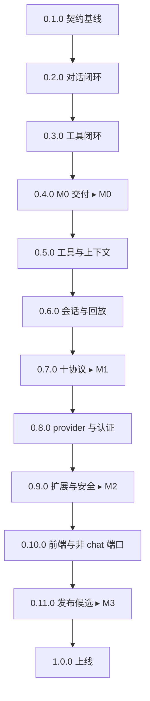

# Pixbot 开发路线图

> **状态**：`0.1.0` 工程与契约基线出口已达成，尚未发布；当前不能调用模型、执行工具或写会话。后续版本能力均为**规划**。
> **职责**：本文是版本编号、迭代边界、出口标准、1.0.0 上线标准与变更机制的**唯一权威来源**；领域语义与算法只链接[架构](architecture.md)与[领域设计](architecture.md#领域设计导航)，不复制；当前实现状态以 [README](../README.md) 与代码为准。

## 1. 阅读方式与版本约定

1. 规则与 DoD 见 [AGENTS.md](../AGENTS.md)；技术语义见 [architecture.md](architecture.md) 及[领域设计导航](architecture.md#领域设计导航)。
2. pi 行为以 `resources/pi/` 源码为唯一事实来源，索引见 [pi-architecture](../resources/pi-architecture.md)。新能力、公共契约或高风险改动先建 [Spec](../.agents/specs/README.md)，多阶段实施再建 [Plan](../.agents/plans/README.md)。
3. `M0`–`M3` 是设计分期标签，`0.x.0` 是其下的交付切片；**版本到里程碑的映射只在本文件维护**。

版本规则：

- 一个 `0.x.0` 承载**一条可独立演示、可独立归因的能力链**，出口必须能用一句话说明「能做什么」；不以功能点数量切版，互不相关的失败面不塞进同一版本。
- `0.x.y` 只做兼容修复，新增能力必须开下一个 minor。
- `0.x` 允许破坏性变更，但发布记录必须写明影响、迁移与回退；持久化字段仍须 `#[serde(default)]` 并保持旧 JSONL 可读。
- `1.0.0` 只在 §6 全部达标后发布，此后破坏性变更必须递增 major。
- 版本号、CHANGELOG 与标签只在实际发布时更新；`apps/Cargo.toml` 的 `version = "0.1.0"` 是脚手架声明，发布时才同步。
- 每个 minor 的固定节奏：复核范围 → 建 Spec 并取得用户确认（写明允许路径与验收命令）→ 实现与测试 → 出口验收并回写 Spec；未确认不得修改生产代码，同一时刻只开一个 minor，未达出口不启动下一版本。
- 同一工作会话内可连续完成多个 minor 的出口验收，但版本号、Spec 与出口证据逐版独立，不合并记录。
- 发布动作（打标签、CHANGELOG 定版）只由用户发起；出口达成但未发布时，验收证据保存在 Spec，不预先写 CHANGELOG。

## 2. 从哪里开始：0.1.0 第一步

0.1.0 不接模型、不执行工具、不写会话；目标是让契约可编译、可测试、依赖方向被守卫。第一行代码不是 provider，而是让 workspace 具备「可判定」的骨架。

### 2.1 开工前阅读（只读）

1. [AGENTS.md](../AGENTS.md)：规则、命令与 DoD。
2. [architecture.md](architecture.md)：分层、全局边界与核心不变量；再读本文 §3 与 §4.1。
3. 契约来源：[上下文设计](design/context.md)（消息双轨）、[Agent 设计](design/agent.md)（事件与 `RunOutcome`）、[会话设计](design/session.md)（`TranscriptEntry`）、[工具设计](design/tools.md)（`ToolResult`）、[Provider 设计](design/providers.md)（`CompletionRequest`／`StreamEvent`）。
4. [TODO](../.agents/todo.md)：0.1.0 的可执行行动。

### 2.2 开工顺序（每步一个提交）

1. **建 Spec**：`.agents/specs/YYYYMMDDHH-design-0-1-0-contract-baseline.md`，范围写 §4.1，验收标准用该节三条出口，允许路径为 `apps/crates/**`、`apps/Cargo.toml`、`scripts/**`；用户确认后才动生产代码。
2. **修 lint 继承**：`apps/crates/cli/Cargo.toml` 增加 `[lints] workspace = true`；在 `apps/Cargo.toml` 的 `[workspace.lints.clippy]` 落地 `unwrap_used`／`expect_used`／`panic` 等 restriction lints 并给测试窄豁免，以实际 clippy 验收。
3. **补 crate 骨架**：建立 `agent`、`context`、`providers`、`tools`、`session`、`config`、`bootstrap`、`headless`；每个 `lib.rs` 写 crate 职责说明，确需错误分类的先定义自己的 `thiserror` 枚举。
4. **契约先行**：在 `contracts` 按序定义 `Role::System` 与消息模型 → `TranscriptEntry::Message` → `ToolResult` → `AgentEvent`／`RunOutcome` → `CompletionRequest`／`StreamEvent` → 端口 trait → 中立错误 → 配置快照；每个类型同步补旧 JSON 兼容与纯函数回归。
5. **建依赖守卫**：新增 `scripts/check-layering.sh`（或等价测试），解析各 crate 的 `[dependencies]`，断言 `L5 → L4 → L3 → L1/L2 → L0`、L1/L2 层内禁呼、端口只在 `contracts`；目录缺失、解析失败或命令失败必须非零退出。
6. **跑出口验证**（`apps/`）：`cargo test --workspace`、`cargo clippy --workspace --all-targets -- -D warnings`、`cargo fmt --all -- --check` 与守卫脚本四条全绿；再按 §4.1 回写 Spec 验收结论与 memory 摘要，本版无用户可感知变化，不写 CHANGELOG。

## 3. 阶段目标、版本总览与依赖关系

### 3.1 阶段性目标与关键里程碑

全计划 11 个 `0.x.0` 切片：M0 交付最小真实闭环；M1 完成核心兼容；M2 完成全量 provider 与通用扩展；M3 完成前端、非 chat 端口与稳定化；全部出口达标后以 `1.0.0` 发布。固定基线计数口径见 [Provider 设计](design/providers.md#固定-pi-基线与分期)，本文不复制清点。`0.1.0` 出口已达成，其余版本均未开始。

| 阶段      | 版本区间              | 阶段性目标                                            | 关键里程碑（出口判据）                         |
| ------- | ----------------- | ------------------------------------------------ | ----------------------------------- |
| M0      | `0.1.0`–`0.4.0`   | 最小真实闭环：契约基线、单协议对话、工具决策闭环、三协议与落盘、headless 与 CI    | `0.4.0` 出口达成且 §5 smoke 完成真实任务       |
| M1      | `0.5.0`–`0.7.0`   | 核心兼容：工具全量与上下文效率、会话树与压缩、十个 chat API               | `0.7.0` 出口达成，固定基线核心项无未说明剩余          |
| M2      | `0.8.0`–`0.9.0`   | 全量 provider 与认证、配置与 trust、hooks、MCP、sandbox、后台任务 | `0.9.0` 出口达成                        |
| M3      | `0.10.0`–`0.11.0` | TUI、image 与 classifier 端口、稳定化与发布候选               | `0.11.0` 产出 `1.0.0-rc`，§6 六类标准全部有证据 |
| `1.0.0` | —                 | 上线发布                                             | §6 逐项核对全部达标后打 `v1.0.0` 标签           |

阶段出口不是把末版改名：必须由区间内每个版本的出口证据**累计**判定；任一版本未达出口，后续版本与阶段出口都不启动。

### 3.2 版本总览

| 版本       | 里程碑 | 能力链             | 预期交付成果                                 | 前置       |
| -------- | --- | --------------- | -------------------------------------- | -------- |
| `0.1.0`  | M0  | 工程与契约基线         | 契约可测试，依赖守卫可拒绝非法依赖；不能调用模型               | —        |
| `0.2.0`  | M0  | 单协议对话闭环         | 真实模型单发对话（OpenAI Completions，无工具）       | `0.1.0`  |
| `0.3.0`  | M0  | 编码工具闭环          | 完成真实编码工具任务（单协议）                        | `0.2.0`  |
| `0.4.0`  | M0  | M0 完整交付         | 三协议、会话落盘、headless 完整与最小 CI，§5 smoke 通过 | `0.3.0`  |
| `0.5.0`  | M1  | 工具全量与上下文效率      | 八工具加 `glob`、工具差量回放、覆盖率与性能基线            | `0.4.0`  |
| `0.6.0`  | M1  | 会话完整性与回放        | 会话树、resume／fork、压缩续跑、trace 回放          | `0.5.0`  |
| `0.7.0`  | M1  | 十个 chat API     | 十个 chat API 全部离线验收                     | `0.6.0`  |
| `0.8.0`  | M2  | 全量 provider 与认证 | 42 个 factory、目录与离线恢复、九个 OAuth          | `0.7.0`  |
| `0.9.0`  | M2  | 扩展与安全边界         | 配置与 trust、hooks、MCP、sandbox、后台任务       | `0.8.0`  |
| `0.10.0` | M3  | 前端与非 chat 端口    | TUI 交互会话；image 与 classifier 端口可验收      | `0.9.0`  |
| `0.11.0` | M3  | 稳定化与发布候选        | §6 全部有证据，产出 `1.0.0-rc`                 | `0.10.0` |
| `1.0.0`  | —   | 上线发布            | §6 全部达标，打 `v1.0.0` 标签                  | `0.11.0` |

### 3.3 依赖关系

版本按编号串行推进（§1 节奏：同一时刻只开一个 minor），因此依赖是一条主链；`0.4.0`、`0.7.0`、`0.9.0`、`0.11.0` 是阶段闸门，未过闸门不得进入下一阶段。



切版依据是**失败面可归因**：每个版本只推进一条能力线，出问题时能定位到唯一方向；下表用于执行时判断「本次改动是否越界」。

| 版本       | 推进的能力线         | 主要失败面（问题定位方向）                     |
| -------- | -------------- | --------------------------------- |
| `0.1.0`  | 工程与契约          | 依赖方向、serde 兼容、端口归属                |
| `0.2.0`  | 模型接入（单协议）      | 协议映射、流事件顺序、认证、重试边界                |
| `0.3.0`  | 工具执行           | 参数校验、配对回填、并发与双序、取消                |
| `0.4.0`  | 持久化 + 前端 + 工程  | 落盘容错、退出码、CLI 入口、CI                |
| `0.5.0`  | 工具全量 + 上下文     | 工具平台差异、差量回放、前缀稳定、度量口径             |
| `0.6.0`  | 会话 + 观测        | 树投影、恢复分叉、压缩切点、预算、trace            |
| `0.7.0`  | 模型接入（全量 chat）  | 各协议差异、thinking signature、usage    |
| `0.8.0`  | Provider 目录与认证 | factory 形态、目录刷新、OAuth 并发          |
| `0.9.0`  | 扩展与安全          | trust 门、hook 白名单、MCP 隔离、隔离失败语义    |
| `0.10.0` | 前端与端口          | 渲染状态、降级、image／classifier 不混入 chat |
| `0.11.0` | 收尾             | 质量门禁、性能复测、平台差异、回退                 |

## 4. 分版本范围、核心任务与出口

一节一条能力链；「范围」是硬边界，「核心任务」按实施优先级排列、只拆解范围内的工作且不重定义范围，「出口」按正常、边界、异常验收，证据写入 Spec 或 Issue，不写在这里。领域语义一律链接对应设计文档。真实凭据 smoke 一律 opt-in：出口以离线契约验收为必达，真实 smoke 未执行须在 Spec 记录原因，不得以占位输出代替。

### 4.1 `0.1.0` — 工程与契约基线

**范围**：按 §2 建立 10-crate 骨架；在 `contracts` 定义端口、事件、配置快照、中立错误、`CompletionRequest`、`StreamEvent`、基础 `TranscriptEntry::Message`、`Role::System` 与 `ToolResult` 形状；建立依赖守卫。不接 provider、工具执行或会话落盘，也不以占位实现冒充已完成。

**核心任务（优先级 = §2.2 实施顺序）**：建 Spec → 修 lint 继承 → 补 crate 骨架 → 契约先行 → 依赖守卫 → 出口验证。

**出口**：正常：旧消息 serde 默认值兼容与事件构造纯函数回归通过，10 个 crate 可构建；边界：运行时事件顺序留给后续版本，不宣称可对话；异常：依赖守卫能拒绝非法 crate 依赖并非零退出。

### 4.2 `0.2.0` — 单协议对话闭环

**范围**：打通 config → bootstrap → agent/context → providers → headless；实现配置快照、API key 认证、模型选择与凭据入口（参数或环境变量的名称由 Spec 固定，§5 smoke 依赖它）、首批静态目录、OpenAI Completions、`to_wire` v1、流式事件映射、请求取消与两层重试边界。provider 层只处理响应头之前的错误；可重试断流只经 `agent::recover::stream_assistant`，abort 不重试。不执行工具、不落盘。

**核心任务（优先级序）**：config 快照、认证与模型选择入口 → OpenAI Completions 协议适配与流事件映射（含响应头前重试、取消）→ `to_wire` v1 与 `CompletionRequest` 构造 → driver 与 `recover::stream_assistant` → bootstrap 装配与 headless 单发入口。

**出口**：正常：fake transport 覆盖文本增量、完成与 usage；边界：`TurnComplete` 为最后事件，`run()` 返回确定 `RunOutcome`，abort 可收敛，无工具调用时不产生 `tool_result`；异常：认证、连接、provider 错误与断流都编码为可诊断的流内结果，无同步抛出路径。

### 4.3 `0.3.0` — 编码工具闭环

**范围**：实现内轮循环、工具注册、参数准备与校验、默认并行、sequential 整批降级、同文件写串行、流式部分结果、取消与双序回填；六个工具只按 [M0 最低行为表](design/tools.md#m0-六工具最低可观察行为) 验收。仍为单协议、不落盘。

**核心任务（优先级序）**：工具注册与 `ToolSet`（注册序稳定）→ dispatch 预备、校验与双序回填 → 并发模型（默认并行、sequential 降级、同文件写串行）→ M0 六工具最低行为 → 流式部分结果与取消。

**出口**：正常：真实工具 smoke 通过，并行、顺序降级、同文件串行、完成序事件与源序结果有测试；边界：取消、部分结果、未执行时 `duration_ms` 为空均有覆盖；异常：未知工具、参数错误、工具异常、最终 Error／Aborted 与 Length 截断都有且仅有一个错误结果，失败只走 `is_error`。

### 4.4 `0.4.0` — M0 完整交付

**范围**：增加 OpenAI Responses 与 Anthropic Messages，统一 text、thinking、tool use、partial JSON、usage 与停止原因映射，保留 Anthropic thinking signature；实现 `~/.pixbot/sessions/<sid>/context.jsonl` 线性追加与 `~/.pixbot/usage-ledger.jsonl` 独立台账（惰性建文件、防抖与退出 flush、坏行诊断、fail-open）；headless 补 `@` 展开、drain（软超时）→ flush → 退出码，移除 repl 骨架与 `--upgrade` 占位（自升级不属于 1.0.0，另行立项），非 `-p` 路径在 TUI 交付前返回可诊断错误；交付最小 CI（fmt／clippy／test／依赖守卫）。不并入 M1～M3 功能。

**核心任务（优先级序）**：OpenAI Responses 适配 → Anthropic Messages 适配 → 线性落盘与用量台账 → headless 完整与 CLI 收口 → 最小 CI → §5 smoke 验收。

**出口**：正常：三个 API 分别用录制响应或 fake transport 验收（不以 OpenAI-compatible 代替 Responses），§5 smoke 完成真实任务，10 个生产 crate、六工具、三个 API、线性落盘与 headless 均有代码与测试；边界：`@` 展开、drain、flush 与 settled 语义通过测试，首条 user／assistant 前不建空文件，旧 JSONL 可读且重载不重排，前端无需第二个结束点；异常：各协议 error 与 abort 编码为流内事件，断流不在 provider 层整轮重试，坏行跳过并诊断、写盘失败只告警、drain 超时与 flush 失败可诊断退出，依赖守卫在 CI 中拒绝非法依赖并非零退出。

### 4.5 `0.5.0` — 工具全量与上下文效率

**范围**：按 [M1 工具基线](design/tools.md#m1-完整-pi-工具基线) 补齐八个内建工具与额外 `glob`（read 图片与缩放、bash 完整输出、powershell、edit 多编辑与 diff、write 在途取消、grep context、find、ls、外部二进制获取／离线规则）；按[请求管线](design/context.md#m1-请求管线) 实现工具差量声明、同名变更按删除＋新增记录与回放重建，固定 system 稳定分节与 `cacheable` 动态边界；引入度量设施：`llvm-cov` 覆盖率基线、七项性能指标的测量口径与脚本（口径在 Spec 固定）、prompt cache 首次测量。不含会话树与压缩。

**核心任务（优先级序）**：八工具加 `glob` → 工具差量声明与回放重建 → 稳定分节与 `cacheable` 动态边界 → 覆盖率与七项测量口径及脚本 → prompt cache 首次测量基线。

**出口**：正常：八工具加 `glob` 的正常路径与 schema 通过，默认活动集（`read/bash/edit/write`）与只读预设（`read/grep/find/ls`）符合基线，差量条目可回放重建，连续内轮稳定前缀一致；边界：截断阈值、图片缩放、空目录、gitignore、hidden 与默认 limit 可观察，差量 system 不进工具列表、无变化不追加、动态内容始终在后；异常：二进制缺失、不可访问路径、非法模式、abort 与 `onUpdate` 都产生可诊断 `is_error`，离线不静默下载，差量解析或工具注册失败可诊断，测量脚本失败可诊断；缓存命中率与覆盖率有首次基线（未达目标不宣称达标）。

### 4.6 `0.6.0` — 会话完整性与回放

**范围**：为 `TranscriptEntry` 增加 `Label`、`ContextEdit` 与父子链接，`SessionRepository` 加载后构建条目树与当前叶子；`branch`／`fork` 以新条目或新文件表达；headless 增加恢复与分叉入口；按 [M1 压缩与清理](design/context.md#m1-压缩与清理) 实现 `Compaction`、autocompact、microcompact 与恢复 Continue，补齐 steering／follow-up 与续跑预算的全队列契约测试；实现 `TraceSink` 把一次 run 的事件与请求摘要写入本地文件并提供回放入口。装配层加载会话，不新增 Agent 路由方法。

**核心任务（优先级序）**：条目树与树投影 → resume／fork → 压缩与切点 → 恢复 Continue 与全队列契约 → trace 与回放。

**出口**：正常：旧线性 JSONL 可重投影为树，恢复叶子后继续，fork 生成独立文件且原文件不变，超阈值触发压缩且投影只采用最新摘要，压缩成功后恢复一次 Continue，trace 可回放并重现事件顺序；边界：孤儿保留原文件但不进投影、重复加载不重排、空会话不建文件，切点不落在 `tool_result`、工具调用与结果同侧、单个超预算 user 以该条目为切点、无可摘要内容不压缩、预算耗尽消息留在队列，关闭 trace 时不产生额外文件；异常：坏行跳过并诊断、写失败只告警、恢复目标缺失可诊断退出，摘要失败或 abort 不重试且保留原上下文，损坏 trace 跳过并诊断。

### 4.7 `0.7.0` — 十个 chat API

**范围**：按 [Provider 分期](design/providers.md#固定-pi-基线与分期) 实现其余七个 chat API，统一 text、thinking、tool use、partial JSON、usage、停止原因与 abort 映射。

**核心任务（优先级序）**：七个 API 协议适配 → 各 API 独立录制响应／fake transport 验收 → thinking signature 与 usage 差异映射测试。

**出口**：正常：七个 API 分别用录制响应或 fake transport 验收，不以 OpenAI-compatible 代替专有协议；边界：不适用项显式说明，thinking signature 与 usage 差异有映射测试；异常：error 与 abort 都编码为流内事件，断流不在 provider 层整轮重试。


### 4.8 `0.8.0` — 全量 provider 与认证

**范围**：按 [Provider 分期](design/providers.md#固定-pi-基线与分期) 完成 42 个 factory 的注册、元数据与认证绑定，41 个 chat 绑定不遗漏（`typesafe` 与 `radius` 按实测形态）；完整静态／动态目录、ModelsStore、离线恢复、ETag／304、custom provider 与混合 API；实现九个 OAuth loader 键的登录、刷新与登出，补齐 key → 存储凭据 → ambient 的解析顺序、刷新并发控制与失败语义。

**核心任务（优先级序）**：42 个 factory 注册与认证绑定 → 目录与 ModelsStore → 离线恢复与 ETag／304 → custom provider 与混合 API → 九个 OAuth 登录／刷新／登出。

**出口**：正常：注册与 chat 绑定无遗漏，目录刷新与离线恢复可用，九个流程可登录、刷新与登出且存储凭据保持独占；边界：`typesafe` 仅 classifier、`radius` 动态 id 不被硬编码假设，304 不重复下载，刷新失败不回退环境变量、类型不匹配返回无凭据、并发刷新只生效一次；异常：单个注册失败告警，目录损坏回退静态快照，生成产物不手改，超时与网络失败可诊断，凭据权限正确且日志不出现密钥。

### 4.9 `0.9.0` — 扩展与安全边界

**范围**：实现全局与项目配置、`${VAR}`／`$VAR`／`!command` 插值、project trust、skills 与 context files 加载及配置写回纪律；进程外 before／after hook 接入 `agent::dispatch`（before 可改参、阻断或 terminate，after 只替换三通道，不新增权限控制流）；MCP 客户端与工具桥接（惰性连接、失败隔离）；bash／powershell 子进程边界的 OS 隔离；长期执行单元、输出落盘、终态 `is_meta` 回流与 `drain_background` 收敛。接入点见[安全设计](design/security.md#扩展接入点总览)。

**核心任务（优先级序）**：三层配置与 trust → skills 与 context files → hooks → MCP → sandbox → 后台任务。

**出口**：正常：三层配置优先级可验证，未信任时跳过项目配置、扩展、MCP 与 skills，context files 随 cwd 加载；hook 改参后再次校验、阻断生成唯一错误结果且不 execute、after 只替换 `content`／`details`／`structured_content`；MCP 工具进入 `ToolSet` 并走同一流水线、首次使用时才连接；sandbox 启用后在隔离边界内执行；后台任务终态以 `is_meta` 进入转录但不回灌主上下文。边界：无 UI 的 trust 默认策略可判定、单资源失败只告警；无 hook 时与 M0 一致、多 hook 顺序确定；MCP 不可达只告警、工具名冲突有确定性规则；sandbox 平台不支持时明确降级或报错；后台输出超限落盘并返回摘要、并发有界。异常：必需凭据缺失可诊断、写回中断不产生半文件、项目资源不绕过 trust；hook 超时或非法输出不跳过配对回填且不覆盖 `is_error`／`terminate`／`usage`；MCP 协议错误与断连可诊断且单服务器失败不阻断回合；隔离失败不得退回无隔离执行，取消与超时仍终止进程树；后台失败、取消与超时产生可诊断终态，退出前 drain 有明确结果。

### 4.10 `0.10.0` — 前端与非 chat 端口

**范围**：从 `AgentEvent` 流重建 TUI 交互视图，处理键盘与差分渲染，与 headless 共用 `AgentSession`，支持 steer／follow-up／interrupt；实现 image 端口与固定基线的 image API，贯通图片请求与结果；实现四个 classifier API 与 `typesafe` 的 classifier-only 形态，补齐 deferred 类型契约与 capability wrapper。不做 repl，不新增驱动路径，image／classifier 不得伪装成 chat stream。

**核心任务（优先级序）**：image 端口与 image API → 四个 classifier 与 deferred 契约 → TUI 视图与交互 → 降级与收尾。

**出口**：正常：交互会话可完成工具任务并正确重绘、取消可收敛，图片结果与用量可验收且 headless 可显式调用，四个 classifier 可执行并返回结构化结果，deferred 只在契约层被引用；边界：窄终端、长输出与无颜色环境可降级且渲染不持有内核状态，不支持图片的模型有明确提示且不混入 chat 决策循环，`typesafe` 不绑定 chat `api`；异常：事件流断开或终端不可用有可诊断退出且退出前 flush 与 drain 生效，图片与 classifier 的认证、连接与限流错误可诊断，classifier 失败可诊断且不把 deferred 描述为已支持。

### 4.11 `0.11.0` — 稳定化与发布候选

**范围**：冻结契约、清理已知限制、收敛质量与性能门禁、修复阻断缺陷；实现 doctor 检查配置、凭据、外部二进制、目录权限与 provider 连通性并给出退出码，排障结论写入 [runbook](runbook.md)；建立三平台 CI 矩阵；补齐迁移与回退文档，产出 `1.0.0-rc`。不新增能力。

**核心任务（优先级序）**：冻结契约与修复阻断缺陷 → 覆盖率收敛到 TS-32 阈值、`audit`／`deny` 清零 → 按 `0.5.0` 口径复测七项性能 → doctor 与 runbook → 三平台 CI 矩阵与 release 构建 → 迁移与回退文档，产出 `1.0.0-rc`。

**出口**：正常：§6 六类标准全部有证据，rc 通过三平台 CI 构建与 smoke，doctor 全项通过返回 0 并输出摘要；边界：已知限制与「明确不做」写入发布说明，缺可选依赖只警告、未配凭据不误报；异常：无未处置安全公告，无密钥或真实数据入库，回退步骤可执行，必需项失败返回非零并给修复建议且输出不含密钥。

## 5. M0 总体边界

M0 即 `0.1.0`–`0.4.0`。最终 smoke 在 `apps/` 执行，并读取仓库根 README：

```bash
cargo run -p cli -- -p "读取 ../README.md 并总结项目结构"
```

该命令必须完成真实模型与工具协同任务，而非打印占位文本；真实凭据只显式提供，不进入仓库或普通 CI。当前不可执行、未通过验收。M0 不包含 §4.5 起的能力，也不包含 repl 与逐工具权限／审批子系统。只有 `0.4.0` 全部出口有代码、测试与发布记录，才能声明 M0 完成。

## 6. 1.0.0 上线标准

`1.0.0` 不是把最后一个 `0.x` 改名：`0.11.0` 出口达成后仍须逐项核对以下六类，全部有证据才打 `v1.0.0`；任一项缺失只能继续发 `0.x.y` 或 `1.0.0-rc.N`。

1. **功能完整**：M0–M3 全部出口有代码与测试；固定基线无未说明剩余项——十个 chat API、42 个 factory、八个内建工具加 `glob`、九个 OAuth 键、一个 image API、四个 classifier API、deferred 仅契约。计数只以 [Provider 设计](design/providers.md#固定-pi-基线与分期) 与[工具设计](design/tools.md#m1-完整-pi-工具基线) 为准。
2. **质量门禁**：AGENTS.md 的 DoD 与 [AR-01](development.md#51-功能版本与兼容性) 全绿；覆盖率按 [TS-32](development.md#43-用例编写与稳定性) 达标；lib 零 panic；依赖守卫在 CI 常驻（自 `0.4.0` 起）。
3. **性能达标**：[架构性能表的七项指标](architecture.md#性能与质量属性) 全部实测达标，按 `0.5.0` 固定的口径记录环境、样本与基线；未测量不得写成达标。
4. **真实端到端**：Linux、macOS、Windows 完成 release 构建与 smoke；真实凭据 e2e 只 opt-in 并单独记录；headless 与 TUI 共用内核，恢复、fork、取消与退出码通过。
5. **安全与合规**：仓库无密钥、token、真实用户数据与本地会话；hooks、sandbox 与 trust 可验收；默认无遥测；`cargo audit`、`cargo deny` 无未处置项。
6. **交付与文档**：产出单一二进制与安装、升级、回退说明；README、runbook、配置文档、API 导航与 CHANGELOG 与代码一致；发布说明含已知限制与[明确不做](product.md#明确不做)；打 `v1.0.0` 标签，此后破坏性变更递增 major。

## 7. 变更机制

**触发**：版本出口达成、真实 smoke 暴露差异、pi 基线差异盘点、依赖选型落地、改变取舍的新 ADR，或外部优先级变化。

**编号稳定**：版本号顺序是规划契约。范围微调留在原版本内；确需插入、合并、拆分或删除时，同时更新 §3 与 §4，并在本节记录「旧 → 新」映射与原因。发布 `0.11.0` 后不再新增 `0.x` 功能版本。

**节奏与沟通**：每个版本边界批量重评下一版本范围，未达当前出口不启动下一版本。变更说明按「内容 → 新证据 → 取舍 → 新计划 → 受影响方」给出；长期取舍进 [decisions.md](decisions.md)，用户可感知变化进 [changelog.md](changelog.md)，版本与出口只改本文。

全局非目标只以 [product.md](product.md) 与 [AGENTS.md](../AGENTS.md) 为准，本文不另列清单。
