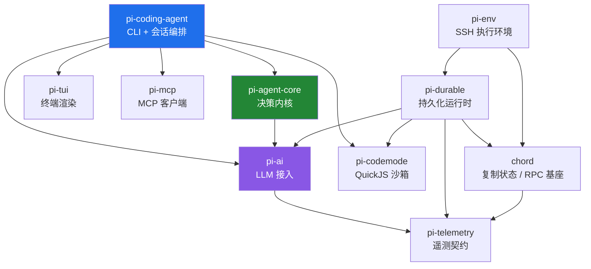
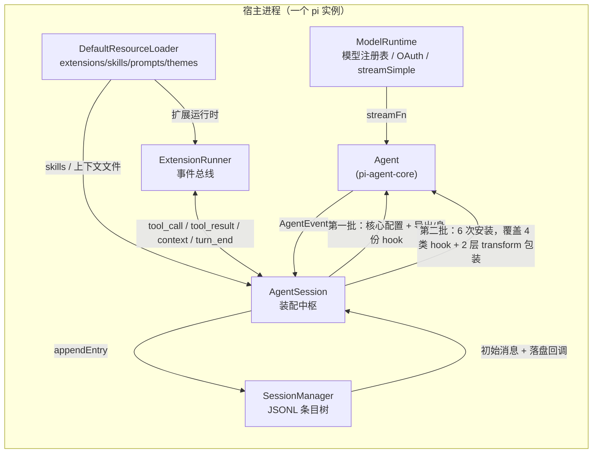
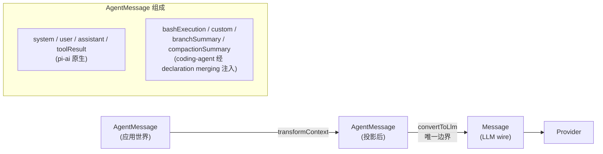
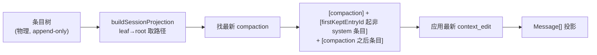
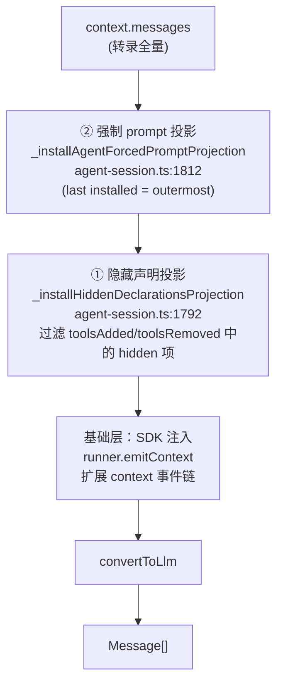
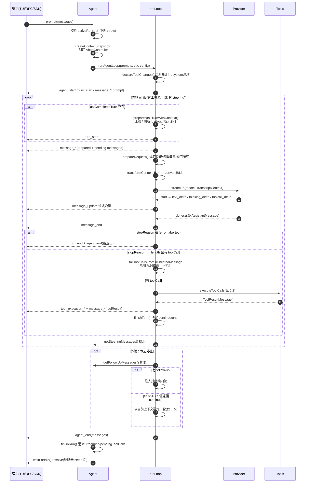
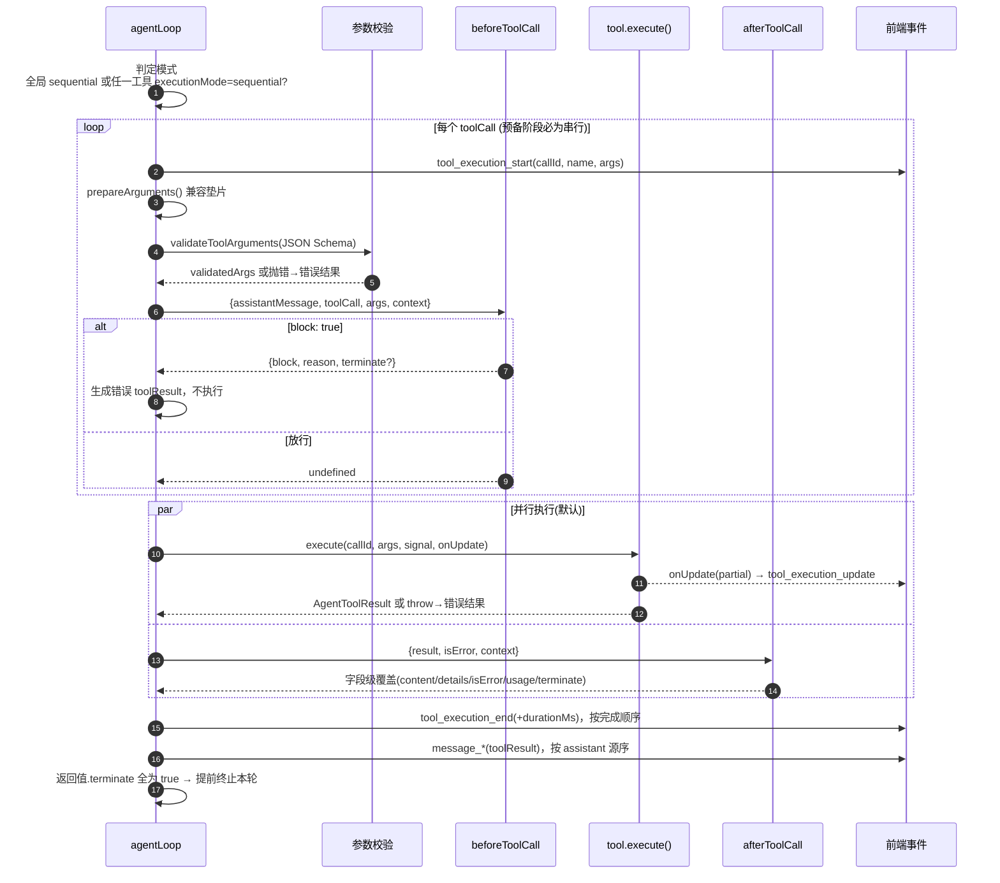
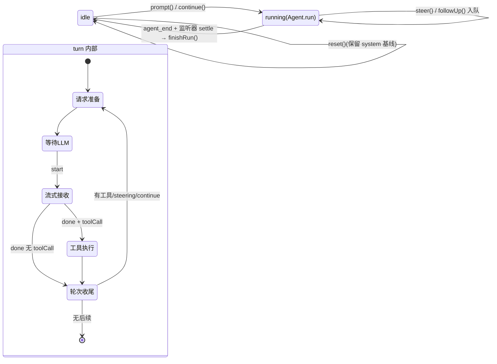
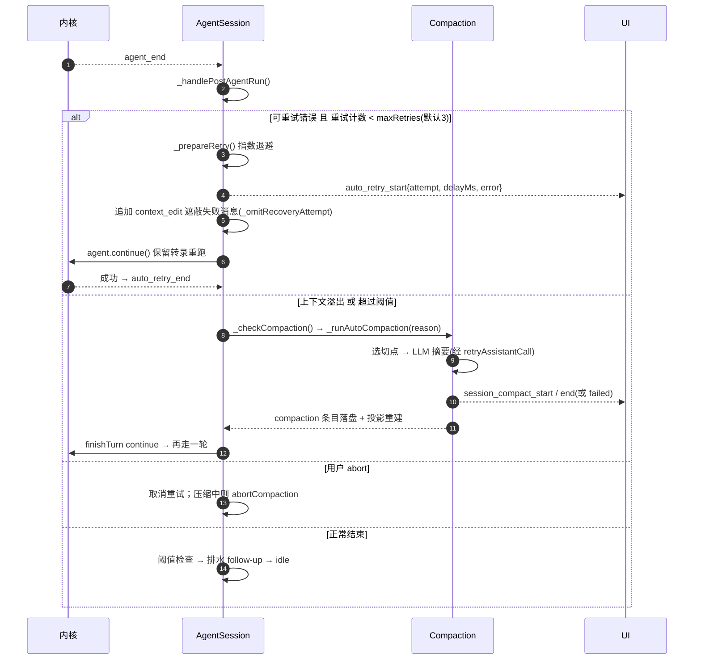
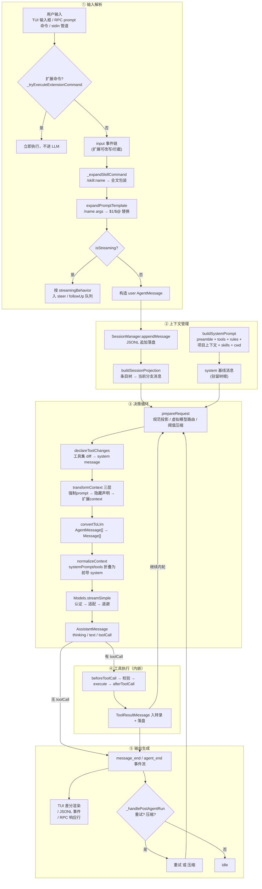

# Pi 系统架构设计文档

> **面向读者**：需要核对 Pixbot 行为对齐依据的开发者。
> **事实基线**：`resources/pi`（pi-mono，TypeScript monorepo，Node ≥ 22.19，各包版本 `1.4.0`）。
> **引用约定**：`packages/...:行号` 均指该基线源码；本文所有结论均可按标注位置逐条复核。
>
> **阅读路径**：§1 理念 → §2 全景 → §3 模块 → §4 数据模型 → §5 时序 → §6 端到端 → §7 源码索引。
> **范围**：只保留 Pixbot 对齐所需的事实与出处；pi 的场景化用法、二次开发指南与复用清单不属于本项目范围，本文不维护。

---

## 0. 一页速览

| 维度 | 结论 |
|---|---|
| 本质 | 一个**极简 Agent Harness**：内核只做「转录维护 + 决策循环 + 事件暴露」三件事 |
| 内核规模 | `pi-agent-core` 仅 **6 个源文件 / 2541 行** |
| 可扩展性 | 全部行为挂在 **9 类 hook + 约 30 个扩展事件**上，内核不含 UI / 提供商 / 持久化知识 |
| 状态模型 | 转录是**唯一事实源**；system prompt 与工具声明**以 system message 形式存在于转录中** |
| 持久化 | append-only JSONL **条目树**（`id`/`parentId`），支持原地分支、fork、压缩、崩溃恢复 |
| 接入形态 | TUI / print / JSON / RPC / TS SDK——**同一内核，五种前端** |
| 取舍 | 不内置子代理、不内置 plan mode、不内置权限系统（交给扩展与容器化） |

---

## 1. 系统概述与核心设计理念

Pi 是一个**最小、可扩展的 Agent Harness**，"把 pi 改造为你的工作流，而不是反过来"（`README.md`）。内核只做三件事：

1. 维护对话转录（`AgentMessage[]`）；
2. 驱动「LLM 响应 → 工具调用 → 结果回填」循环；
3. 把全过程以事件流（`AgentEvent`）暴露给任意前端。

其余一切——工具集、UI、权限策略、上下文压缩，乃至子代理与 plan mode——**都在内核之外**通过 hook 或扩展注入。

### 1.1 七条核心设计理念

| # | 理念 | 说明 | 源码证据 |
|---|------|------|----------|
| 1 | **转录单一事实源** | 没有独立的 `systemPrompt` 字段。system prompt 与工具声明以 `SystemMessage` 存活在转录里；运行时工具集与转录已声明工具集的差量，在每次请求前折算为 `toolsAdded`/`toolsRemoved` 写入新的 system message | `agent-loop.ts:342`（`declareToolChanges`）；`ai/src/utils/transcript.ts:150`（`getToolStateChanges`） |
| 2 | **AgentMessage ≠ LLM Message** | 内核只在**一次**边界上做转换（`convertToLlm`），应用可经 declaration merging 注入自定义消息类型（如 `bashExecution`、`compactionSummary`），这些类型永不直接泄漏给提供商 | `agent/src/types.ts:365-374`；`ai/src/utils/transcript.ts:30`（`normalizeContext`） |
| 3 | **控制反转** | 内核不认识任何 LLM 提供商。LLM 调用是注入的 `StreamFn`；宿主通过 `Models.streamSimple` 提供实现 | `agent/src/stream-fn.ts`；`agent/src/types.ts:33-37` |
| 4 | **契约式错误处理** | `StreamFn` 与全部 hook 的契约是「**不得 throw**，失败编码进返回值」。LLM 失败 → `stopReason:"error"/"aborted"` 的 `AssistantMessage`；工具失败 → `isError:true` 的 `AgentToolResult` | `agent/src/types.ts:27-32` 及各 hook JSDoc |
| 5 | **事件驱动的无状态前端** | 循环只发事件，UI 从事件流重建视图，不在内核里持有任何渲染状态 | `agent/src/types.ts:516-539` |
| 6 | **能力显式暴露** | 工具不是「注册即可见」。`ToolExposure` 区分 `direct`/`model-only`/`codemode`/`deferred`/`hidden`，只有 `direct` 进模型工具列表 | `coding-agent/src/core/extensions/types.ts:522` |
| 7 | **无内置权限系统** | 以启动进程的用户权限运行；运行时权限 = 订阅 `tool_call` 返回 `{block:true}`；硬隔离交给容器化（Gondolin / Docker / OpenShell） | `README.md` "Permissions & Containerization" |

### 1.2 关键设计取舍

| 取舍 | 代价 | 收益 |
|---|---|---|
| 不内置子代理 / plan mode | 开箱能力弱于重度 Agent 产品 | 内核保持 6 文件，语义可完全掌握；子代理用扩展即可实现（工具内部再开一个循环） |
| 工具默认**并行**执行 | 需要工具自行处理并发写冲突（用 `file-mutation-queue` 串行化同文件写） | 多工具批次的墙钟时间大幅下降；单工具可 `executionMode:"sequential"` 退化 |
| 上下文以**压缩**为主 | 需要额外一次 LLM 调用生成摘要 | 保留近期对话的完整语义，而非静默截断 |
| 会话是**树**而非数组 | 投影逻辑复杂（分支、摘要、`context_edit`） | fork / resume / 时间旅行都是树操作，零拷贝 |
| provider 层**默认不重试**（`retry.provider.maxRetries = 0`） | 瞬时网络抖动会冒泡到会话层 | 配额/计费类错误能立刻被会话层识别并终止，不被重试掩盖（`docs/settings.md:136`） |

---

## 2. 系统整体架构

### 2.1 分层视图

```
┌──────────────────────────────────────────────────────────────────────────┐
│ 接入层  TUI(pi-tui) │ print │ JSON(JSONL事件) │ RPC(JSONL命令) │ TS SDK    │
│         main.ts resolveAppMode 统一分流                                    │
├──────────────────────────────────────────────────────────────────────────┤
│ 会话编排层 (coding-agent/src/core)                                          │
│  AgentSession ─ 状态机/命令展开/重试/压缩编排/hook 接线  agent-session.ts   │
│  SessionManager ─ JSONL 条目树 + 投影                  session-manager.ts │
│  DefaultResourceLoader ─ 扩展/技能/模板/主题/上下文文件 resource-loader.ts  │
│  ExtensionRunner ─ 扩展事件总线                         extensions/runner.ts│
│  buildSystemPrompt ─ 分节式提示组装                     system-prompt.ts   │
│  tools/ ─ read/write/edit/bash/grep/find/ls/powershell                    │
├──────────────────────────────────────────────────────────────────────────┤
│ Agent 运行时 (pi-agent-core, 6 文件)                                       │
│  Agent     ─ 有状态封装 + steering/followUp 双队列      agent.ts           │
│  agentLoop ─ 双层循环：内轮(工具/steer) + 外轮(follow-up) agent-loop.ts    │
│  9 类 hook ─ convertToLlm/transformContext/beforeToolCall/...             │
├──────────────────────────────────────────────────────────────────────────┤
│ LLM 接入层 (pi-ai)                                                         │
│  Models 注册表 │ 42 providers │ 10 chat API │ 流式事件协议 │ 重试 │ OAuth  │
├──────────────────────────────────────────────────────────────────────────┤
│ 支撑设施                                                                   │
│  pi-mcp(MCP客户端) │ pi-codemode(QuickJS沙箱) │ pi-telemetry(遥测契约)     │
│  pi-tui(终端渲染)                                                          │
│  ── 独立产品线（服务端/远程执行，不在 CLI 链路）──                          │
│  pi-durable(持久化运行时) │ pi-env(SSH执行环境) │ chord(复制状态/RPC 基座)  │
└──────────────────────────────────────────────────────────────────────────┘
```

### 2.2 包依赖图（依据各包 `package.json`，已逐一核实）



**必须澄清的三点**（常见误读）：

1. `pi-mcp`、`pi-codemode`、`pi-tui` 是**零内部依赖**的叶子包，它们**不依赖** `pi-ai`。MCP 工具桥接为 `AgentTool` 的适配代码在 `coding-agent` 侧（`src/extensions/mcp/tools.ts`），不在 `pi-mcp` 内。
2. **`chord` 不被 `coding-agent` 依赖**。它在 `1.4.0` 已从 CLI 链路移除（`packages/coding-agent/CHANGELOG.md:192`）。RPC 模式走的是**自带的 JSONL over stdio**（`src/modes/rpc/jsonl.ts`），与 chord 无关。chord 的真实消费者是 `pi-durable` 与 `pi-env`。
3. `pi-durable` / `pi-env` 不是玩具实验：`durable` 约 2.5 万行源码 + 6000 行规范，四种存储后端（Memory / IndexedDB / SQLite / JSONL）；`env` 含一个约 5000 行的 Rust daemon。它们是**面向服务端与远程执行场景的第二条产品线**，只是不参与 CLI 主链路。

### 2.3 运行时对象装配



`AgentSession`（`agent-session.ts:485`）是装配中枢，分**两批**安装 hook：

- **第一批**（`core/sdk.ts:403` 构造 `Agent` 时）：`convertToLlm`、`streamFn`、`transformContext`（**基础层**）、`onPayload`、`onResponse`、`onProviderStreamEvent`、`sessionId`、`steeringMode`、`followUpMode`、`transport`、`thinkingBudgets`、`maxRetryDelayMs`。
- **第二批**（`AgentSession` 构造期 `agent-session.ts:514-520`，共 6 次安装）：`beforeToolCall`+`afterToolCall`（1 次安装）、`prepareNextTurnWithContext`、`prepareRequest`、`finishTurn`，以及 `transformContext` 的**两层包装**（隐藏声明、强制 prompt）。

理解这个「两批安装 + 每层包装前序实现」的模式，是理解 pi 扩展性的关键——见 §4.4。

---

## 3. 功能模块划分

### 3.1 模块职责总表

| 包 | 职责 | 不负责 | 规模 |
|---|---|---|---|
| `pi-agent-core` | 决策循环、转录与运行时状态、事件、工具执行编排 | UI、持久化、提供商、压缩策略 | 6 文件 |
| `pi-ai` | 消息/流式协议类型、提供商适配、模型目录、认证、重试、计费 | Agent 循环、会话 | 204 文件 / 42 providers |
| `pi-coding-agent` | CLI、会话状态机、持久化、压缩、扩展、内置工具、四种前端 | LLM 协议细节、终端原语 | 254 文件 |
| `pi-tui` | 终端渲染（差分）、组件树、布局、输入解析、图像协议 | 业务语义 | 46 文件 |
| `pi-mcp` | MCP 客户端（tools + resources）、三传输、OAuth | 把 MCP 工具变成 Agent 工具 | 18 文件 |
| `pi-codemode` | 沙箱内执行模型写的 JS，唯一能力是调用注入工具 | 工具实现本身 | 17 文件 |
| `pi-telemetry` | 厂商中立的 trace/metric 契约 + 一致性测试 | 导出器实现 | 8 文件 |
| `pi-durable` | 崩溃可恢复的 conversation/task/document 运行时 | CLI 交互 | 85 文件 |
| `pi-env` | SSH 上的远程 `ExecutionEnv` 实现 | 会话与任务语义 | 8 TS + 16 Rust |
| `chord` | 类型化契约、复制状态、delta 编码、JSON 链路上 RPC、热重载 | Agent 语义 | 163 文件 |
| `pi-evals` | 行为评测（vitest-evals + Docker 隔离 arms、docs lift） | 不参与 CLI 主线 | 5 文件 |

### 3.2 `pi-agent-core` — 决策内核

6 个源文件，职责 = **循环 + 状态 + 事件**，不含任何 UI / 持久化 / 提供商知识。

| 文件 | 职责 | 关键导出 |
|------|------|----------|
| `agent-loop.ts` | 无状态双层循环；工具执行编排；工具集差量声明 | `agentLoop` `agentLoopContinue` `runAgentLoop` `runToolCall` |
| `agent.ts` | 有状态封装：转录 / 工具 / 流式状态、双队列、abort、事件分发 | `Agent` |
| `types.ts` | 全部契约类型 | `AgentMessage` `AgentState` `AgentTool` `AgentEvent` `AgentLoopConfig` |
| `stream-fn.ts` | `StreamFn` 服务定位器（控制反转） | `setDefaultStreamFn` `getDefaultStreamFn` |
| `proxy.ts` | 代理 `StreamFn` 的包装工具 | — |
| `index.ts` | 导出面 | — |

#### 3.2.1 `AgentLoopConfig` 的 9 类扩展点

`agent/src/types.ts:193-342`。这是 pi 可扩展性的全部来源：

| Hook | 调用时机 | 契约 | 典型用途 |
|------|----------|------|----------|
| `convertToLlm`（**必选**） | 每次 LLM 请求前 | `AgentMessage[] → Message[]`，不得 throw | 过滤 UI-only 消息；自定义消息转 user |
| `transformContext` | `convertToLlm` **之前** | `AgentMessage[] → AgentMessage[]`，不得 throw | 上下文裁剪、注入外部上下文、隐藏声明投影 |
| `getApiKey` | 每次请求前 | 不得 throw，无 key 返回 `undefined` | 过期 OAuth token 动态刷新 |
| `finishTurn` | 每轮结束、`turn_end` 之前 | 返回 `{action:"continue"\|"end"}` | 扩展强制续跑、提前终止 |
| `prepareRequest` | 每次请求前（含首次） | 可替换 context/model/thinkingLevel | 规范投影重建、虚拟模型路由、阈值压缩 |
| `prepareNextTurn` | 轮次之间 | 可替换 context/model/thinkingLevel + 追加消息 | 长耗时准备（如压缩） |
| `getSteeringMessages` | 内轮排水点 | 不得 throw，无消息返回 `[]` | steering 队列排水 |
| `getFollowUpMessages` | agent 本应停止时 | 不得 throw，无消息返回 `[]` | follow-up 队列排水 |
| `beforeToolCall` / `afterToolCall` | 参数校验后 / 执行后 | 前者可 `{block}`，后者字段级覆盖结果 | 权限拦截 / 结果改写 |

#### 3.2.2 `Agent` 公开接口

`agent/src/agent.ts:194`：

| 方法 | 语义 | 备注 |
|------|------|------|
| `prompt(input, images?)` | 注入 user 消息并跑一轮 | **运行中调用会 throw**，不是静默排队（`agent.ts:383`） |
| `continue()` | 从当前转录续跑 | 末条消息必须是 user/toolResult（`agent.ts:393`） |
| `steer(msg)` / `followUp(msg)` | 入对应队列 | 默认 `one-at-a-time` 排水（`agent.ts:255-256`） |
| `steeringMode` / `followUpMode` | `"all"` \| `"one-at-a-time"` | 可运行时切换 |
| `abort()` | 中止当前 run | 经 `AbortSignal` 同时传播到请求与工具 |
| `waitForIdle()` | 等 `agent_end` **及其监听器 settle** | 真正的结束点（`agent.ts:359`） |
| `reset()` | 清队列与转录，保留 system 基线 | 运行中调用会 throw |
| `subscribe(fn)` | 订阅事件，**串行**分发 | 监听器可 async，被 await（`agent.ts:275, 575`） |
| `state` | `AgentState` 只读视图 | 含 `isStreaming` `streamingMessage` `pendingToolCalls` `errorMessage` |

> **易错点**：`Agent.prompt()` 在运行中会抛错，排队语义由调用方显式选择（`AgentSession.prompt()` 在流式期间要求显式传 `streamingBehavior: "steer"|"followUp"`，否则同样抛错，`agent-session.ts:2142-2145`）。

#### 3.2.3 事件协议

`types.ts:516-539`，四层生命周期嵌套：

```
agent_start
└─ turn_start
   ├─ message_start / message_end            (user、system、toolResult)
   ├─ message_start / message_update* / message_end   (assistant，仅此处有 update)
   ├─ tool_execution_start
   ├─ tool_execution_update*                 (工具流式部分结果)
   ├─ tool_execution_end                     (含 durationMs)
   └─ turn_end { message, toolResults }
└─ agent_end { messages }
```

`agent_end` 是最后一个事件，但**run 并未结束**——必须等所有 await 的监听器 settle，`waitForIdle()` 才 resolve（`agent.ts:568-575` 注释）。这是 RPC 模式要求「等 `agent_settled` 而非 `agent_end`」的根因。

### 3.3 `pi-ai` — LLM 统一接入层

| 子模块 | 职责 | 源码 |
|--------|------|------|
| 类型层 | `Message` / `AssistantMessage` / `ToolCall` / `ThinkingContent` / `Usage`；`Api = KnownApi \| string` 开放扩展 | `src/types.ts:64-76, 422-457, 585-616, 659` |
| 流式协议 | `AssistantMessageEvent` 12 个变体；`EventStream` async iterator | `src/types.ts:821-837`；`utils/event-stream.ts:26-135` |
| 提供商适配 | 42 provider / 10 个 chat API 模块，统一实现 `ProviderStreams` | `src/api/*.ts`；`src/providers/all.ts:136` |
| 注册表 | `Models`：静态目录 + `models.json` 叠加 + 扩展注册 | `src/models.ts:400-1026` |
| 转录工具 | `normalizeContext` / `getCurrentTools` / `getToolStateChanges` / `toToolDeclaration` | `utils/transcript.ts:10-167` |
| 参数校验 | `validateToolArguments`（TypeBox + 自定义 JSON Schema 兼容层） | `utils/validation.ts:317` |
| 重试 | provider 级（`retryProviderRequest`）+ 调用级（`retryAssistantCall`）双层 | `utils/provider-retry.ts:107`；`utils/retry.ts` |
| 认证 | 显式 key → stored credential → 环境变量；9 个 OAuth provider | `auth/resolve.ts:33-93`；`auth/oauth/load.ts:14` |
| 计费 | `calculateCost`：按百万 token 费率 + 分层阈值 | `src/models.ts:1236` |

**两个关键契约**：

1. **`stream()` vs `streamSimple()`**：前者接受提供商原生选项，后者是**中立翻译层**（把 `reasoning: ThinkingLevel` 映射到各家的 `reasoningEffort`/`thinkingBudget`，并按上下文窗口 clamp `maxTokens`），最终都调用 `stream()`。
2. **`Models.streamSimple()` 永不同步抛错**：认证/模块加载失败经 `lazyStream` 编码为流内的 `error` 事件（`src/api/lazy.ts:60-86`）。这是上层能用统一转录回放判断结局的前提。

### 3.4 `pi-coding-agent` — 编码 Agent 本体

#### 3.4.1 编排核心

| 模块 | 职责 | 关键接口 |
|------|------|----------|
| `agent-session.ts`（4463 行） | 会话状态机：命令/技能/模板展开、双队列、自动重试、abort、压缩编排、hook 接线、事件分发与落盘 | `prompt():2097` `steer():2280` `followUp():2296` `compact():2833` `navigateTree():4029` |
| `session-manager.ts`（2028 行） | JSONL 条目树、v1→v2→v3 迁移、投影、fork/resume | `create/open/continueRecent/forkFrom/inMemory`、`buildSessionProjection()` |
| `compaction/compaction.ts` | 阈值判定、切点选择、摘要生成 | `shouldCompact():269`、默认设置 `:126-130` |
| `system-prompt.ts` | 分节式提示组装（preamble + XML 分节） | `buildSystemPrompt()`、`buildSystemPromptSections():128` |
| `extensions/{loader,runner}.ts` | jiti 直载 TS 扩展；约 30 种事件分发 | `ExtensionRunner.emit*` |
| `resource-loader.ts` | 扩展/技能/模板/主题/上下文文件发现与加载 | `DefaultResourceLoader.reload()` |
| `tools/` | 8 个内置工具 + 7 个渲染器实现（`powershell` 复用 `bash` 的渲染器） | `createAllToolDefinitions()` |

#### 3.4.2 内置工具

`ToolName = "read" | "bash" | "powershell" | "edit" | "write" | "grep" | "find" | "ls"`（`tools/index.ts:95`）。

| 工具 | 关键设计 |
|------|----------|
| `bash` / `powershell` | 共用 `createShellToolDefinition`；流式输出；超限写临时文件并返回 `fullOutputPath`；timeout kill |
| `read` | 分页（offset/limit）、默认 2000 行 / 50KB 截断、图片转 `ImageContent` |
| `edit` | `edits[].oldText` 必须唯一且互不重叠；BOM/换行归一化；产出 `diff/patch/firstChangedLine` |
| `write` | 全文件写入，自动建父目录，经 `withFileMutationQueue` 串行化 |
| `grep` / `find` | 依赖 `rg` / `fd`（`ensureTool` 负责定位或下载） |
| `ls` | 目录枚举，含 dotfiles |

**工具定义的「双面性」**：每个 `ToolDefinition` 同时携带 `promptSnippet`/`promptGuidelines`（注入 system prompt）与 `renderCall`/`renderResult`（TUI 渲染）。一个文件同时服务模型侧与 UI 侧。

#### 3.4.3 工具暴露级别

`ToolExposure`（`extensions/types.ts:522`）：

| 级别 | 进模型工具列表 | 可达路径 |
|------|:---:|------|
| `direct` | ✅ | 模型直接调用 |
| `model-only` | ❌ | 仅供内部/嵌套调用 |
| `codemode` | ❌ | 通过 codemode 脚本 |
| `deferred` | ❌ | 经 `tool_search` 按需加载后进入列表 |
| `hidden` | ❌ | 完全不可达 |

#### 3.4.4 扩展系统

- **注册面**：`registerTool` `registerCommand` `registerProvider` `registerMcpServer` `registerMessageRenderer` `registerToolRenderer` `registerShortcut` `registerFlag`。
- **事件面**（约 30 种）分四组：启动/信任（`project_trust` `resources_discover`）、会话（`session_start` `session_before_switch` `session_before_compact` `session_shutdown`）、上下文/provider（`context` `before_provider_request` `after_provider_response`）、Agent/工具（`before_agent_start` `tool_call` `tool_result` `turn_end` `agent_before_settle`）。
- **组合语义**：按加载顺序 + 注册顺序执行；`tool_call` 返回 `{block}` 立即短路；`context`/`tool_result`/`input` 是**链式转换**。
- **两阶段加载**：先只加载全局/内置扩展 → 用它们裁定 `project_trust` → 再完整加载项目扩展（`resource-loader.ts:532-552`）。

### 3.5 支撑包

#### 3.5.1 `pi-tui`

| 概念 | 事实 |
|------|------|
| 渲染契约 | `Component.render(width): string[]` ——**没有 `measure()`**，尺寸靠行数推断（`tui.ts:117`） |
| 差分算法 | 每帧全量渲染到内存 → 逐行**字符串比较**求变更区间 → 仅输出变更行（`tui-main-screen.ts:247-460`） |
| 强制整屏重绘 | 首帧 / 宽度变化 / 高度变化（Termux 豁免）/ 内容变短且开启 `clearOnShrink` |
| 同步输出 | 整段包裹在 CSI 2026 中（`\x1b[?2026h` … `\x1b[?2026l`），消除闪烁 |
| 两种屏 | `TuiMainScreen`（依赖终端滚动缓冲区）vs `TuiAltScreen`（应用自持视口 + `LayoutBox` 树） |
| 布局 | 栈式 flex 近似：`basis`/`grow`/`shrink`/`minSize`/`maxSize`/`gap`/`align`（`stack.ts:135`）。**不是 CSS flexbox** |
| 编辑器 | Emacs 语义：kill-ring / yank-pop / undo-stack / `Intl.Segmenter` 词边界（`editor.ts` 2473 行） |
| 原生模块 | 仅剪贴板与修饰键（darwin/win32/linux-x11）；终端尺寸与图像协议在 TS 层 |
| 图像协议 | Kitty（分块 base64 + 图像 ID 管理）与 iTerm2（OSC 1337） |

#### 3.5.2 `pi-mcp`

- 协议版本：`2025-11-25`，兼容 `2025-06-18` / `2025-03-26` / `2024-11-05`。
- 传输：`stdio`（进程组终止）、`streamable-http`（SSE + `Mcp-Session-Id` + `Last-Event-ID` 续传）、`in-memory`（测试）。
- **协议面是子集**：只有 `tools`、`resources`、`resourceTemplates`、`callTool`、`readResource`、`ping`。**没有** prompts / sampling / tasks —— 这是明确的架构取舍，不要写成「完整 MCP 客户端」。
- OAuth：`WWW-Authenticate` 发现 → AS 元数据 → PKCE → 回调服务器 → 令牌交换/刷新 → `stepUpScope` 提权。
- 桥接位置在 `coding-agent`（`src/extensions/mcp/tools.ts`）：工具名 `mcp__<server>__<tool>`，非 `[A-Za-z0-9_]` 字符替换为 `_`，过长时追加哈希后缀截断（`:79-89`）；输出按 20KB 中段截断。

#### 3.5.3 `pi-codemode`

- 沙箱一律是 **QuickJS WASM**（`quickjs-wasi`），不是 Node `vm`。
- 四种宿主：Node worker（`SharedArrayBuffer` + `Atomics` 中断）、内联（interrupt budget，默认 100,000 polls）、远程（Durable Object RPC）、Cloudflare DO。
- 能力面：`tools.*`、`ALL_TOOLS`、`searchTools`、`describeTool`、`store()/load()`、`text()/image()/console.log/exit()`。
- 确定性模式（`start()`）：固定 UTC、seed PRNG、`timezoneOffset: 0`、禁用 `WeakRef`，并产出 `started` **fingerprint**（QuickJS 版本 + prelude 哈希 + 预算），供 durable 判定可重放性。
- 源码头文法：首行 `// @options: {...}` 只接受 `max_output_tokens` / `timeout_ms`，解析后替换为空行以保持行号。

#### 3.5.4 `pi-durable` / `pi-env` / `chord` / `pi-telemetry`

| 包 | 核心模型 |
|---|---|
| `pi-durable` | **不是事件溯源**。是「原子提交的不可变记录批（conversation/entry/task/submission）+ Chord 跟踪的可变文档（base/delta 修订）」。`Storage.commit(writes, adopt)` 契约：存储负责「原子写 + 恰好一次 adopt」，Session 负责 adopt 之后的发布。四种后端：Memory / IndexedDB / SQLite / JSONL |
| `pi-durable` 任务 | 无「任务类」，是**声明 + 调度器驱动**：`defineTask()` 返回定义，`TaskScheduler`（2528 行）执行「读 checkpoint → 执行 effect → 返回下一 state」的效果三明治；崩溃恢复 = `open()` 把 `running` 改回 `pending` 并 `restarts + 1` |
| `pi-env` | `ExecutionEnv` 接口定义在 durable；env 提供 SSH 实现 + Rust daemon。帧协议 `u32 len │ u8 type │ u32 id │ u32 jsonLen │ json │ payload`，`MAX_FRAME` 16MiB，5s ping / 30s 静默超时 |
| `chord` | 「对象 = 地址上的状态 + 代码」；只传引用不传对象；状态以 JSON 快照 + delta 复制；支持热重载（prepare → vote → commit/abort → retire） |
| `pi-telemetry` | 无 exporter、无 OTLP 依赖；**用回调显式传递 span，不用 `AsyncLocalStorage`**（为了边缘运行时可移植）；已接入 `ai` / `durable` / `chord`，**未接入** `agent` 与 `coding-agent` |

---

## 4. 核心数据模型

### 4.1 消息双轨制



关键点：

- 应用可无限扩展消息类型，**只有 `convertToLlm` 一处**需要知道如何降级。
- coding-agent 的降级表（`core/messages.ts:148-196`）：`bashExecution` → 带命令与退出码的 user 文本（`excludeFromContext` 时**丢弃**）；`custom` → user；`branchSummary`/`compactionSummary` → 加前后缀的 user。
- `AgentToolResult` 三通道：`content`（模型可见）、`details`（UI/日志）、`structuredContent`（程序化调用方，**不发给模型**）。

### 4.2 工具模型

```ts
interface AgentTool<TParameters, TDetails> extends Tool<TParameters> {  // agent/src/types.ts:466
  label: string
  prepareArguments?: (args: unknown) => Static<TParameters>   // schema 校验前的兼容垫片
  outputSchema?: TSchema                                      // structuredContent 的 schema
  execute(toolCallId, params, signal?, onUpdate?): Promise<AgentToolResult<TDetails>>
  replay?: "never" | "safe"                                   // 结果未知时的恢复策略
  executionMode?: "sequential" | "parallel"                   // 默认 parallel
}
```

失败语义（**必须遵守**）：throw，或返回 `isError: true` 的结果。**只把错误写进 `content` 而不置 `isError` 是错误用法**——模型会把它当成成功观察。

### 4.3 会话持久化模型

**位置**：`~/.pi/agent/sessions/--<cwd 编码>--/<timestamp>_<session-id>.jsonl`（`session-manager.ts:589-602`）。注意**不是** `.pi/sessions/`；项目 `.pi` 默认只放配置。

**结构**：每行一个 JSON 对象；首行 `SessionHeader`；其余条目靠 `id`/`parentId` 组成树。`CURRENT_SESSION_VERSION = 3`。

| 条目类型 | 语义 | 进 LLM 上下文 |
|----------|------|:---:|
| `message` | 对话消息 | ✅（经 convertToLlm） |
| `model_change` / `thinking_level_change` | 运行时配置变更 | ❌ |
| `usage` | token 记账 | ❌ |
| `compaction` | 摘要 + `firstKeptEntryId` + 可选 system checkpoint | 摘要✅ 原文❌ |
| `branch_summary` | 分支切换时对放弃分支的摘要 | 摘要✅ |
| `custom` | 扩展私有状态 | ❌ |
| `custom_message` | 扩展注入消息 | ✅ |
| `context_edit` | 追加式遮蔽/改写某条历史条目 | 改投影 |
| `label` / `session_info` | 书签 / 会话名 | ❌ |

**惰性落盘**：`_persist()`（`session-manager.ts:1172`）首写前先问 `_hasConversation()`（`:1166`），只有出现**第一条 user 或 assistant 消息**时才用 `openSync(..., "wx")` 把全部内存条目刷成文件，之后改为 `appendFileSync`。

两个设计意图值得借鉴：

- 打开 pi 但没聊天 → 只有 model/thinking/system 等设置条目 → **不产生空会话文件**。
- 门槛设在 **user** 消息而非第一条 assistant 回复，是为了「首轮未跑完也保住用户的 prompt」（源码注释标注 issue #10000）。

**投影**：`buildSessionProjection()` 把条目树投影为「当前分支消息序列 + model + thinkingLevel」，是恢复、预算、压缩取料的统一入口。



### 4.4 上下文投影链（顺序极重要）

`Agent.transformContext` 支持**包装叠加**：每层 `const prev = agent.transformContext; agent.transformContext = async (m) => f(await prev(m))`。

因此**最后安装的是最外层**。coding-agent 的实测执行顺序（自外向内）为：



> **易错点**：安装顺序是「先隐藏声明，后强制 prompt」，但执行顺序相反（外层先跑）。若把两层顺序画反，会误判「强制 prompt 是否会裁掉隐藏声明的过滤结果」——实际是强制 prompt 最后执行，它会把所有 system 折叠为一条 head 并保留当前 `toolsAdded`。

**请求前的完整管线**（一次 `streamAssistantResponse` 内，`agent-loop.ts:390-417`）：

```
prepareRequest（规范投影重建 / 虚拟模型路由 / 阈值压缩）
  → declareToolChanges（工具集 diff → 新的 system message）
  → transformContext（上述三层）
  → convertToLlm（AgentMessage → Message）
  → normalizeContext（折叠 systemPrompt/tools 为前导 system message）
  → getApiKey（动态解析）
  → streamFn(model, TranscriptContext)
```

### 4.5 用量与成本

`Usage`（`ai/src/types.ts:459-487`）：

```ts
{ input, output, cacheRead, cacheWrite, cacheWrite1h?, reasoning?, totalTokens,
  cost: { input, output, cacheRead, cacheWrite, total, totalFromProvider? } }
```

`calculateCost()`（`models.ts:1236`）的三条规则：

1. 费率单位是 **USD / 百万 token**。
2. 分层阈值按**整个请求的输入 token 总数**（`input + cacheRead + cacheWrite`）匹配，取满足条件的最高阈值。
3. Anthropic 的 1h cache write 按 **2 倍 input 费率**计费；其余 cache write 按 `cacheWrite` 费率。
4. `totalFromProvider` 仅在 provider 直接上报账单成本时为 `true`（目前已知：OpenRouter）；否则 `total` 是目录估算值——**做成本统计时必须区分二者**。

---

## 5. 关键流程时序

### 5.1 Agent 运行机制：双层主循环

`agent-loop.ts:172` `runLoop`。**内轮** = 「assistant 响应 → 工具执行 → steering 排水」；**外轮** = agent 本应停止时检查 follow-up。



**四个易被误解的机制**：

1. **steering ≠ follow-up**：steering 在「本轮工具执行完、下次请求前」注入，**不打断**已发出的工具调用；follow-up 在 agent 本应停止时接管并触发新 turn。默认均 `one-at-a-time`。
2. **显式续跑**：`finishTurn` 返回 `{action:"continue"}` 且无队列消息时，循环「以不变上下文再走一轮」——这是压缩后自动继续、扩展强制续跑的共同基础。
3. **截断安全**：`stopReason === "length"` 时，消息内**所有** tool call 一律不执行。原因：流式参数经 JSON 打捞后可能「语法合法但内容残缺」，执行比不执行更危险（`agent-loop.ts:481-513`）。
4. **续跑前提**：`agentLoopContinue()` 要求末条消息能映射为 user 或 toolResult，否则 LLM 会拒绝请求；因 `convertToLlm` 每轮只调一次，此处无法预先校验（`agent-loop.ts:76-79` 注释）。

### 5.2 工具调用生命周期

`agent-loop.ts:518` `executeToolCalls`。



**并行模式的三个精确语义**（最易写错）：

1. **预备阶段严格串行**：`beforeToolCall` 与参数校验按顺序逐个执行，只有通过后才并发执行。
2. **`tool_execution_end` 按完成顺序发射**，但 **toolResult 消息按 assistant 源序发射**——保证转录里工具结果的顺序稳定，不受调度影响。
3. **提前终止要求全集**：`shouldTerminateToolBatch`（`agent-loop.ts:700`）要求批次内**每一个** finalized 结果都 `terminate: true`，任一为 false 则继续。

**abort 传播**：预备与执行间隙反复检查 `signal.aborted`；已预备未执行者产出 "Operation aborted" 结果而非静默丢弃。**嵌套调用**必须走 `runToolCall()`（`agent-loop.ts:821`），使权限等 hook 对工具内部的再次调用同样生效。

### 5.3 状态流转



- **Agent 侧状态**：`isStreaming`、`streamingMessage`（`message_start`/`message_update` 维护）、`pendingToolCalls`（`Set`，由 `tool_execution_start/end` 维护）、`errorMessage`（`turn_end` 时从 `assistant.errorMessage` 提取）。
- **AgentSession 侧状态**：`isCompacting`、重试计数、`queueLengths`、`_failedResponse`（供下一次 `prepareRequest` 判定 `reason: "retry"`）。

### 5.4 会话级错误恢复

`_handlePostAgentRun()`（`agent-session.ts:1984`）在每次 run 结束后做恢复判定：



**压缩的三个触发点**（避免只写一个）：

| 触发点 | 位置 | 时机 |
|---|---|---|
| `prepareRequest` | `agent-session.ts:787` | 每次请求前（含首次），虚拟模型路由后 |
| `prepareNextTurnWithContext` | `agent-session.ts:898` | 每轮结束、下一响应前 |
| `_checkCompaction` | `agent-session.ts:3016` | run 结束兜底 |

阈值公式：`contextTokens > contextWindow - reserveTokens`，默认 `reserveTokens = 16384`、`keepRecentTokens = 20000`（`compaction.ts:126-130, 269`）。

**切点规则**：从最新条目往回累加 token 至 `keepRecentTokens`，再对齐到最近的合法切点——合法切点为 user / assistant / bashExecution / custom message，**绝不切在 toolResult 处**（否则工具调用与结果分离，LLM 会拒绝）。若单个 user span 本身超预算，允许在 assistant 处切并标记 `isSplitTurn`。

---

## 6. 端到端数据流程

四个阶段：**输入解析 → 上下文管理 → 决策循环 → 输出生成**（工具执行是决策循环的内嵌环节）。五种前端共用此链路，仅出口不同。



### 6.1 数据形态变迁总表

| 阶段 | 形态 | 承载者 | 备注 |
|---|---|---|---|
| 输入 | `string` + `ImageContent[]` | 前端 | |
| 展开 | `string`（技能/模板已展开） | `AgentSession` | 展开只发生在 `prompt()` 入口 |
| 应用消息 | `AgentMessage` | `Agent.state.messages` | 可含扩展自定义类型 |
| 持久化 | `SessionEntry`（JSONL 行） | `SessionManager` | append-only，不可变 |
| 投影 | `AgentMessage[]`（当前分支） | `buildSessionProjection` | 已应用 compaction / context_edit |
| 上下文 | `AgentMessage[]`（投影后） | `transformContext` | 三层包装 |
| wire | `Message[]` | `convertToLlm` | 仅 4 种 role |
| 请求 | `TranscriptContext`（branded） | `normalizeContext` | system prompt 已折叠进消息 |
| 响应 | `AssistantMessage` | `pi-ai` | 含 `usage` 与 `stopReason` |
| 工具结果 | `AgentToolResult` → `ToolResultMessage` | `agent-loop` | 三通道分离 |
| 输出 | `AgentEvent` 流 | `Agent` | 前端据此渲染 |

---

## 7. 附录：源码快速索引

| 主题 | 位置 |
|------|------|
| 双层主循环 | `packages/agent/src/agent-loop.ts:172` |
| 工具执行编排 | `agent-loop.ts:518`；嵌套调用 `runToolCall:821` |
| 工具集差量声明 | `agent-loop.ts:342`；`ai/src/utils/transcript.ts:150` |
| 截断消息安全处理 | `agent-loop.ts:488` |
| 批次提前终止 | `agent-loop.ts:700` |
| Agent 封装 / 双队列 | `agent/src/agent.ts:194`；队列 `:149, 255` |
| 事件与 hook 契约 | `agent/src/types.ts:193-342`（config）、`:516`（events） |
| 流式事件协议 | `ai/src/types.ts:821-837`；`utils/event-stream.ts:26-135` |
| 模型注册表 | `ai/src/models.ts:400`；`streamSimple:929`；`calculateCost:1236` |
| 转录工具函数 | `ai/src/utils/transcript.ts:10-167` |
| 参数校验 | `ai/src/utils/validation.ts:317` |
| 认证解析优先级 | `ai/src/auth/resolve.ts:33-93` |
| AgentSession | `coding-agent/src/core/agent-session.ts:485` |
| hook 安装（两批） | 第一批 `core/sdk.ts:403`；第二批 `agent-session.ts:514-520` |
| 投影链 | `agent-session.ts:1792`（隐藏声明）、`:1812`（强制 prompt） |
| 工具钩子 | `agent-session.ts:652`（安装）、`:659`（before）、`:685`（after） |
| 请求/轮次钩子 | `agent-session.ts:787`（prepareRequest）、`:898`（nextTurn）、`:886`（finishTurn） |
| 事件分发与落盘 | `agent-session.ts:1103` |
| 恢复编排 | `agent-session.ts:1984`、`_checkCompaction:3016`、`_prepareRetry:3827` |
| 会话条目与投影 | `coding-agent/src/core/session-manager.ts`（类 `:987`、惰性落盘 `_persist:1172` / `_hasConversation:1166`） |
| 压缩 | `core/compaction/compaction.ts`（默认 `:126`、`shouldCompact:269`） |
| 系统提示 | `core/system-prompt.ts:128`（分节）、`:88`（规则） |
| 内置工具 | `core/tools/`（注册 `index.ts:95`） |
| 扩展系统 | `core/extensions/{types,loader,runner}.ts`；`docs/extensions.md` |
| 启动装配 | `coding-agent/src/main.ts`（`resolveAppMode:112`） |
| RPC 协议 | `modes/rpc/{rpc-mode,rpc-types,jsonl}.ts`；`docs/rpc.md` |
| MCP 桥接 | `extensions/mcp/tools.ts`；`packages/mcp/src/client.ts` |
| codemode | `packages/codemode/src/runtime/`；`extensions/codemode/` |
| durable | `packages/durable/src/{session,harness,storage}/`、`docs/spec.md` |
| env 协议 | `packages/env/{docs/protocol.md,daemon/src/frame.rs}` |
| TUI 差分渲染 | `packages/tui/src/tui-main-screen.ts:247` |
| 官方机制说明 | `coding-agent/docs/how-pi-works.md` |
